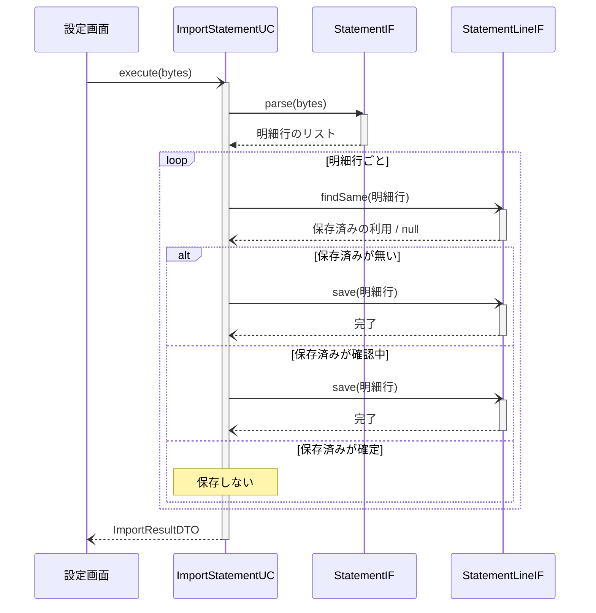

# PRC-001 利用明細CSVの取込（ImportStatementUC）

## 概要

利用明細CSVの内容を、保存済みの明細行に取り込む。取り込む規則は [csv-format.md](../../csv-format.md) に従う。

## 実装箇所

| 役割 | ファイル | クラス |
|---|---|---|
| 処理本体 | `lib/application/usecase/settings/import_statement_uc.dart` | `ImportStatementUC` |
| 結果の受け渡し | `lib/application/dto/import_result_dto.dart` | `ImportResultDTO` |
| 使う窓口（CSVの読み取り） | `lib/application/interface/statement_if.dart` | `StatementIF` |
| 使う窓口（明細行の保存・取得） | `lib/application/interface/statement_line_if.dart` | `StatementLineIF` |

## 呼び出し箇所

- 現時点で呼び出す箇所はない
- 設定画面（仕様書 3.3）の「取り込み」操作が呼び出す

## 入力

- CSVのバイト列（`Uint8List`）

## 手順

1. `StatementIF` でバイト列を明細行のリストに変換する
2. リストの明細行ごとに、`StatementLineIF` で、キーが同じ保存済みの明細行を探す
3. 保存済みの状態に応じて、次のように扱う

| 保存済みの状態 | 扱い | 件数 |
|---|---|---|
| なし | 新規に保存する | 追加 |
| 確定 | 保存せず、保存済みの値を残す | 無視 |
| 確認中 | 取り込む明細行で置き換える | 上書き |

## シーケンス図

## 出力

- 取込結果（`ImportResultDTO`）: 追加・上書き・無視の件数

## エラー時の動作

- CSVが不正なときは、何が不正かを示す `FormatException` を投げる
- 手順1で変換が終わるまで何も保存しないので、不正なCSVのときは既存のデータを変えない

## 関連するテスト

- 単体: `test/application/usecase/settings/import_statement_uc_test.dart`（上書き規則のパターン、同じCSVの再取込、不正なCSV）
