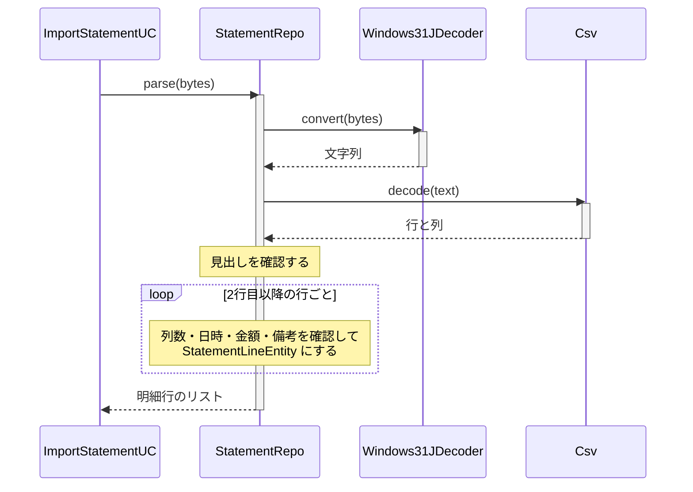

# PRC-002 利用明細CSVの読み取り（StatementRepo）

## 概要

利用明細CSV（Shift_JIS系の CP932）のバイト列を、CSVの1行ごとの明細行（`StatementLineEntity`）に変換して、CSVの行の順に並べたリストにする。列・日付形式・金額の空欄の扱いは [csv-format.md](../../csv-format.md) に従う。

## 実装箇所

| 役割 | ファイル | クラス |
|---|---|---|
| 処理本体 | `lib/infrastructure/repository/settings/statement_repo.dart` | `StatementRepo` |
| 実装する窓口 | `lib/application/interface/statement_if.dart` | `StatementIF` |
| 文字コードの変換 | パッケージ `jis0208` | `Windows31JDecoder` |
| CSVの分割 | パッケージ `csv` | `Csv` |

## 呼び出し箇所

- PRC-001（`ImportStatementUC`）が、`StatementIF` を通して呼び出す

## 入力

- CSVのバイト列（`Uint8List`）

## 手順

1. バイト列を CP932（Shift_JIS）として文字列に変換する。Shift_JIS で読むのはCSVの取り込み時だけで、変換後は Unicode の文字列として扱い、DBにはUTF-8で保存する（[TBL-001](../tables/TBL-001-statement-lines.md)）
2. 文字列を行と列に分割する。各列の前後の空白は取り除く
3. 1行目を見出しとして、15列の名前が仕様と完全に一致することを確認する。半角表記など、一致しない見出しはエラーにする
4. 2行目以降を、1行ずつ明細行に変換する
   - 列数が15でなければエラー
   - 入口の日付と時刻は、両方が空欄なら `null`。片方だけの空欄はエラー
   - 出口の日付（`yy/mm/dd`）と時刻（`HH:mm`）は必須。存在しない日付はエラー
   - 「車種」は1〜5の番号。それ以外はエラー。番号は `VehicleTypeValue` に変換する
   - 「車両番号」は数字。数字でなければエラー（メッセージに値は含めない）
   - 入口ICは空欄なら `null`。出口ICとETCカード番号は必須
   - 「割引前料金」「ＥＴＣ割引額」は空欄なら `null`。「通行料金」「還元額適用料金」「後納料金」の空欄はエラー。金額の桁区切りのカンマは取り除く
   - 「備考」は `;` で分け、「確定」「確認中」のどちらか一方を状態にする。残りを割引種別にする

## シーケンス図

## 出力

- 明細行（`StatementLineEntity`）のリスト。CSVの2行目以降の行の順に並ぶ。データ行が無いときは空のリスト

## エラー時の動作

- 形式に合わないときは、何が不正かを示す `FormatException` を投げる。メッセージには行番号と列名を含め、車両番号とETCカード番号の値は含めない
- 不正な行を黙って捨てない
- 1行でも不正なら、一覧を返さない

## 関連するテスト

- 単体: `test/infrastructure/repository/settings/statement_repo_test.dart`（正常系、車種の番号、金額の空欄、入口の空欄、備考の判定、列数不足、見出しの不一致、文字コード）
