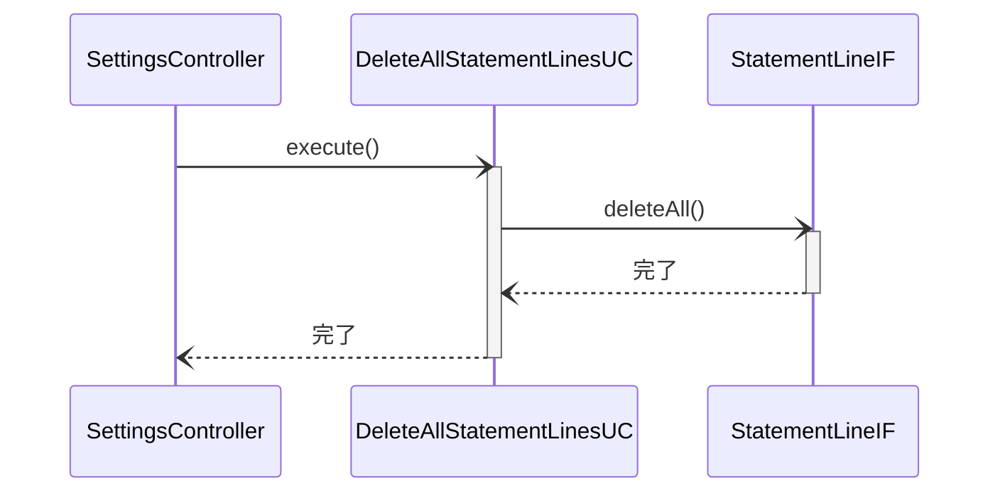

# PRC-003 取り込んだ明細行の全削除（DeleteAllStatementLinesUC）

## 概要

端末内に保存した明細行を、すべて削除する。

## 実装箇所

| 役割 | ファイル | クラス |
|---|---|---|
| 処理本体 | `lib/application/usecase/settings/delete_all_statement_lines_uc.dart` | `DeleteAllStatementLinesUC` |
| 使う窓口（明細行の保存・取得） | `lib/application/interface/statement_line_if.dart` | `StatementLineIF`（`deleteAll`） |
| 窓口の実装 | `lib/infrastructure/repository/statements/statement_line_repo.dart` | `StatementLineRepo` |

## 呼び出し箇所

- [SCR-001](../screens/SCR-001-settings.md) の OP-2（データを削除する）が、確認ダイアログで「削除する」を選んだあとに呼び出す

## 入力

- なし

## 手順

1. `StatementLineIF` の `deleteAll` を呼び、保存済みの明細行をすべて削除する

## シーケンス図

## 出力

- なし（完了したら戻る）

## エラー時の動作

- 削除に失敗したときは、例外をそのまま呼び出し元に返す。呼び出し元（画面）が ER-3 を表示する

## 関連するテスト

- 単体: `test/application/usecase/settings/delete_all_statement_lines_uc_test.dart`（保存済みの明細行がすべて無くなること、何も無いときも失敗しないこと）
