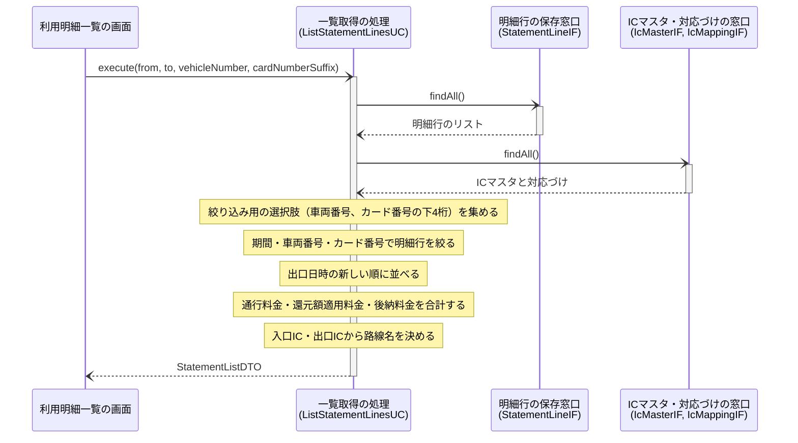

# PRC-004 明細行の一覧の取得（ListStatementLinesUC）

## 概要

保存済みの明細行を、絞り込み条件で絞り、出口日時の新しい順に並べて、合計金額とともに返す。仕様は [specification.md](../../specification.md) の 3.1 に従う。

## 実装箇所

| 役割 | ファイル | クラス |
|---|---|---|
| 処理本体 | `lib/application/usecase/statements/list_statement_lines_uc.dart` | `ListStatementLinesUC` |
| 結果の受け渡し | `lib/application/dto/statement_list_dto.dart` | `StatementListDTO` |
| 結果の明細行 | `lib/application/dto/statement_line_dto.dart` | `StatementLineDTO` |
| 使う窓口（明細行の保存・取得） | `lib/application/interface/statement_line_if.dart` | `StatementLineIF`（`findAll`） |
| 使う窓口（ICマスタ） | `lib/application/interface/ic_master_if.dart` | `IcMasterIF`（`findAll`） |
| 使う窓口（ICの対応づけ） | `lib/application/interface/ic_mapping_if.dart` | `IcMappingIF`（`findAll`） |
| 使う部品（絞り込み、DTOへの詰め替え） | `lib/application/usecase/statements/statement_filter.dart` | `filterStatementLines`、`toStatementLineDTO` ほか。[PRC-009](PRC-009-list-route-map.md) と共通 |
| 使う部品（IC名の照合、路線名の決定） | `lib/application/usecase/ic_mapping/ic_lookup.dart` | `IcLookup` |
| 使う部品（ICマスタに無い路線の補足） | `lib/application/usecase/ic_mapping/ic_route_supplements.dart` | `routeSupplementOf` |

## 呼び出し箇所

- [SCR-002](../screens/SCR-002-statement-list.md) の OP-1（一覧を表示する）と OP-2（絞り込む）が呼び出す

## 入力

| 名前 | 型 | 意味 |
|---|---|---|
| `from` | `DateTime?` | 期間の開始日。`null` なら下限なし |
| `to` | `DateTime?` | 期間の終了日。`null` なら上限なし |
| `vehicleNumber` | `int?` | 車両番号。`null` なら絞らない |
| `cardNumberSuffix` | `String?` | ETCカード番号の下4桁。`null` なら絞らない |

- `from`、`to` は日付だけを使う（時刻は無視する）

## 手順

1. `StatementLineIF` の `findAll` で、保存済みの明細行をすべて取得する。`IcMasterIF` と `IcMappingIF` の `findAll` で、ICマスタと対応づけを取得し、`IcLookup` を作る
2. 絞り込み用の選択肢を作る。絞り込む前の全明細行から、車両番号（数の小さい順）とETCカード番号の下4桁（文字の順）を、重複なく集める
3. 次の条件をすべて満たす明細行に絞る（`null` の条件は使わない）
   - 出口日時の日付が、`from` 以後（`from` を含む）
   - 出口日時の日付が、`to` 以前（`to` を含む）
   - 車両番号が `vehicleNumber` と等しい
   - ETCカード番号の下4桁が `cardNumberSuffix` と等しい
4. 出口日時の新しい順に並べる（同じ日時は、保存済みの順のまま）
5. 絞った明細行の、通行料金・還元額適用料金・後納料金を、それぞれ合計する（確認中の明細行も含める）
6. `Entity` を `StatementLineDTO` に詰め替える。ETCカード番号は、下4桁にして入れる（元の番号は入れない）。路線名は、`IcLookup` に入口IC・出口ICを渡して決める（規則は [route-map.md](../../route-map.md) の「路線名」）

## シーケンス図

## 出力

`StatementListDTO`

| 項目 | 型 | 内容 |
|---|---|---|
| `lines` | `List<StatementLineDTO>` | 絞った明細行（出口日時の新しい順） |
| `totalFare` | `int` | 通行料金の合計（円） |
| `totalFareAfterRebate` | `int` | 還元額適用料金の合計（円） |
| `totalPostpaidFare` | `int` | 後納料金の合計（円） |
| `vehicleNumberChoices` | `List<int>` | 絞り込みで選べる車両番号 |
| `cardNumberChoices` | `List<String>` | 絞り込みで選べるETCカード番号（下4桁） |

`StatementLineDTO`（一覧・タイムラインの表示と、[SCR-003](../screens/SCR-003-statement-detail.md) の詳細に使う）

| 項目 | 型 | 内容 |
|---|---|---|
| `entranceAt` | `DateTime?` | 入口日時。空欄のときは `null` |
| `exitAt` | `DateTime` | 出口日時 |
| `entranceIc` | `String?` | 入口IC。空欄のときは `null` |
| `exitIc` | `String` | 出口IC |
| `grossFare` | `int?` | 割引前料金。割引なしのときは `null` |
| `etcDiscount` | `int?` | ETC割引額。割引なしのときは `null` |
| `fare` | `int` | 通行料金 |
| `fareAfterRebate` | `int` | 還元額適用料金 |
| `postpaidFare` | `int` | 後納料金 |
| `vehicleType` | `VehicleTypeValue` | 車種 |
| `vehicleNumber` | `int` | 車両番号（個人情報） |
| `cardNumberSuffix` | `String` | ETCカード番号の下4桁 |
| `status` | `ConfirmationStatusValue` | 状態 |
| `discountTypes` | `List<String>` | 割引種別（無いときは空） |
| `routeNames` | `List<String>` | 路線名（通行した高速道路）。決められないときは空 |

## エラー時の動作

- 保存済みの明細行の取得に失敗したときは、例外をそのまま呼び出し元に返す。呼び出し元（画面）が ER-1 を表示する

## 関連するテスト

- 単体: `test/application/usecase/statements/list_statement_lines_uc_test.dart`（0件、並び順、期間の境界日を含むこと、車両番号・カード番号の絞り込み、合計と内訳、入口が空欄の行、選択肢が絞り込み前の全体から作られること、カード番号が下4桁になること、割引種別・車種・車両番号・割引前料金などが詰め替えられること、路線名が共通・和集合・片方のみ・無しになること。補足の路線（入口が空欄を含む）は、`ic_lookup_test.dart`）
