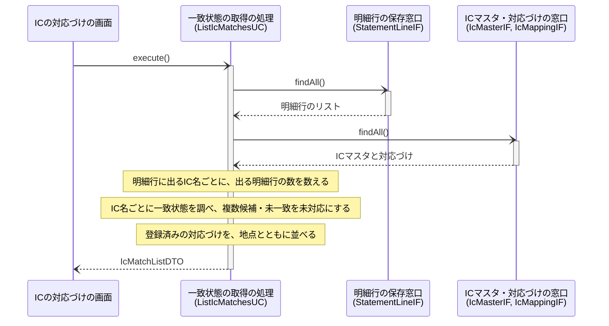

# PRC-005 IC名の一致状態の一覧の取得（ListIcMatchesUC）

## 概要

保存済みの明細行に出てくるIC名について、ICマスタの地点に決まるかどうかを調べ、利用者が対応づけを決める必要があるIC名と、登録済みの対応づけを返す。照合の規則は [route-map.md](../../route-map.md) に従う。

## 実装箇所

| 役割 | ファイル | クラス |
|---|---|---|
| 処理本体 | `lib/application/usecase/ic_mapping/list_ic_matches_uc.dart` | `ListIcMatchesUC` |
| 結果の受け渡し | `lib/application/dto/ic_match_list_dto.dart` | `IcMatchListDTO` |
| 結果の1件 | `lib/application/dto/ic_match_dto.dart` | `IcMatchDTO` |
| 結果の地点 | `lib/application/dto/ic_point_dto.dart` | `IcPointDTO` |
| 使う部品（IC名の照合） | `lib/application/usecase/ic_mapping/ic_lookup.dart` | `IcLookup`（`resolve`） |
| 使う窓口（明細行） | `lib/application/interface/statement_line_if.dart` | `StatementLineIF`（`findAll`） |
| 使う窓口（ICマスタ） | `lib/application/interface/ic_master_if.dart` | `IcMasterIF`（`findAll`） |
| 使う窓口（ICの対応づけ） | `lib/application/interface/ic_mapping_if.dart` | `IcMappingIF`（`findAll`） |
| 窓口の実装 | `lib/infrastructure/repository/ic_mapping/ic_master_repo.dart`、`ic_mapping_repo.dart` | `IcMasterRepo`、`IcMappingRepo` |

## 呼び出し箇所

- [SCR-004](../screens/SCR-004-ic-mapping.md) の OP-1（一覧を表示する）が呼び出す

## 入力

- なし

## 手順

1. `StatementLineIF` の `findAll` で明細行を、`IcMasterIF` の `findAll` でICマスタを、`IcMappingIF` の `findAll` で対応づけを取得し、`IcLookup` を作る
2. 明細行に出てくるIC名（入口IC・出口IC。入口ICが空欄のときは数えない）ごとに、そのIC名が出る明細行の数を数える（入口と出口が同じIC名でも、1行は1回と数える）
3. IC名ごとに `IcLookup` の `resolve` で一致状態を調べる。「複数候補」と「未一致」のIC名を、未対応の一覧にする。複数候補のときは、候補の地点も付ける。明細行の数が多い順、同じなら名前の順に並べる
4. 対応づけごとに、IC名とIC地点（マスタに無いときは `null`）を、登録済みの一覧にする。IC名の順に並べる。そのIC名が出る明細行の数も付ける（出ないときは0）

## シーケンス図

## 出力

`IcMatchListDTO`: `unresolved`（`List<IcMatchDTO>`、未対応）、`registered`（`List<IcMatchDTO>`、登録済み）

`IcMatchDTO`

| 項目 | 型 | 内容 |
|---|---|---|
| `icName` | `String` | CSVのIC名 |
| `state` | `IcMatchValue` | 未対応のときは `ambiguous`（複数候補）か `unknown`（未一致）。登録済みのときは `registered` |
| `lineCount` | `int` | そのIC名が出る明細行の数 |
| `candidates` | `List<IcPointDTO>` | 複数候補のときの候補。それ以外は空 |
| `point` | `IcPointDTO?` | 登録済みのときの地点。マスタに無いときと、未対応のときは `null` |

`IcPointDTO`: `id`、`name`、`kind`（`IcKindValue`）、`latitude`、`longitude`、`routeNames`（`List<String>`）

## エラー時の動作

- 取得に失敗したときは、例外をそのまま呼び出し元に返す。呼び出し元（画面）が ER-1 を表示する

## 関連するテスト

- 単体: `test/application/usecase/ic_mapping/ic_mapping_uc_test.dart`（一致するIC名は出ないこと、複数候補と未一致、明細行の数と並び順、登録済み、マスタに無い登録済み、入口が空欄の行、0件）
- 単体: `test/application/usecase/ic_mapping/ic_lookup_test.dart`（照合の順序、正規化、末尾の除去、複数候補、登録の優先、路線名の決定）
