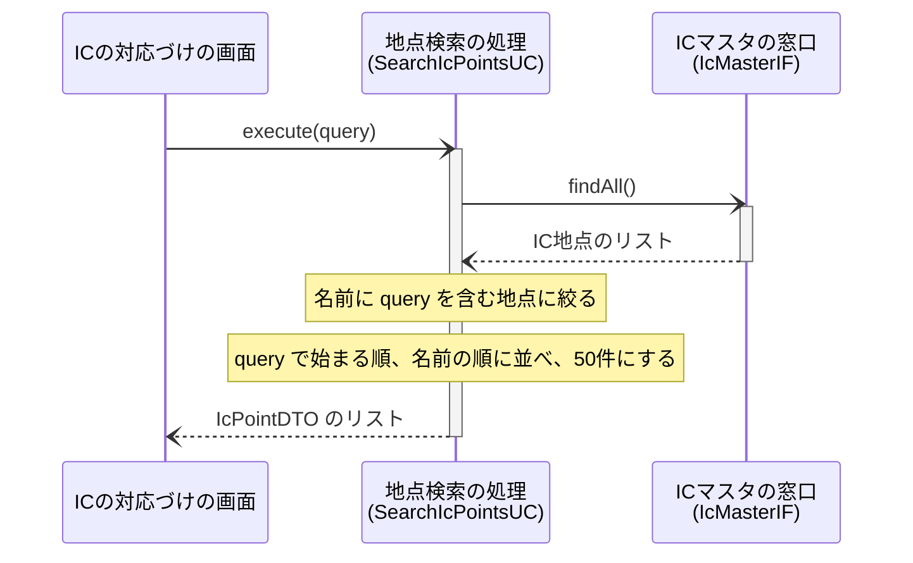

# PRC-006 IC地点の検索（SearchIcPointsUC）

## 概要

利用者が対応づけの地点を選ぶために、ICマスタの地点を、名前で探す。

## 実装箇所

| 役割 | ファイル | クラス |
|---|---|---|
| 処理本体 | `lib/application/usecase/ic_mapping/search_ic_points_uc.dart` | `SearchIcPointsUC` |
| 結果の地点 | `lib/application/dto/ic_point_dto.dart` | `IcPointDTO` |
| 使う窓口（ICマスタ） | `lib/application/interface/ic_master_if.dart` | `IcMasterIF`（`findAll`） |

## 呼び出し箇所

- [SCR-004](../screens/SCR-004-ic-mapping.md) の OP-2（地点を探す）が呼び出す

## 入力

| 名前 | 型 | 意味 |
|---|---|---|
| `query` | `String` | 探す文字。空欄（空白だけを含む）のときは、何も返さない |

## 手順

1. `query` の前後の空白を取り除く。空なら、空のリストを返す
2. `IcMasterIF` の `findAll` でICマスタを取得する
3. 名前（全角の英数字・記号を半角にし、小文字にして、空白を取り除く。[route-map.md](../../route-map.md) の「そろえる」）に、`query`（同じようにそろえる）を含む地点に絞る
4. 名前が `query` で始まるものを先に、そのあとは、名前の順に並べる。50件まで返す

## シーケンス図

## 出力

- `List<IcPointDTO>`（最大50件）

## エラー時の動作

- ICマスタの取得に失敗したときは、例外をそのまま呼び出し元に返す。呼び出し元（画面）が ER-2 を表示する

## 関連するテスト

- 単体: `test/application/usecase/ic_mapping/ic_mapping_uc_test.dart`（空欄、全角・半角と大文字・小文字の違い、前方一致が先、50件、見つからないとき、取得の失敗）
