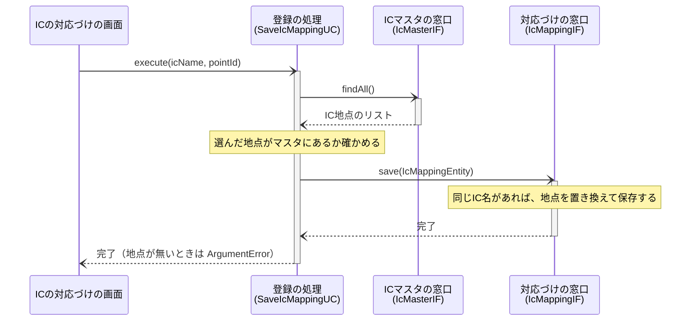

# PRC-007 ICの対応づけの登録（SaveIcMappingUC）

## 概要

CSVのIC名と、ICマスタの地点の対応づけを、端末内に登録する。同じIC名があれば、地点を置き換える。

## 実装箇所

| 役割 | ファイル | クラス |
|---|---|---|
| 処理本体 | `lib/application/usecase/ic_mapping/save_ic_mapping_uc.dart` | `SaveIcMappingUC` |
| 使う窓口（ICマスタ） | `lib/application/interface/ic_master_if.dart` | `IcMasterIF`（`findAll`） |
| 使う窓口（ICの対応づけ） | `lib/application/interface/ic_mapping_if.dart` | `IcMappingIF`（`save`） |
| 窓口の実装 | `lib/infrastructure/repository/ic_mapping/ic_mapping_repo.dart` | `IcMappingRepo`（[TBL-002](../tables/TBL-002-ic-mappings.md)） |

## 呼び出し箇所

- [SCR-004](../screens/SCR-004-ic-mapping.md) の OP-3（地点を選んで登録する）が呼び出す

## 入力

| 名前 | 型 | 意味 |
|---|---|---|
| `icName` | `String` | CSVのIC名 |
| `pointId` | `String` | 選んだIC地点のID |

## 手順

1. `IcMasterIF` の `findAll` で、`pointId` の地点があるか確かめる。無ければ `ArgumentError` を投げる（何も保存しない）
2. `IcMappingIF` の `save` で、IC名と地点のIDを保存する

## シーケンス図

## 出力

- なし（完了したら戻る）

## エラー時の動作

- 地点がマスタに無いときは `ArgumentError`。保存に失敗したときは、その例外。呼び出し元（画面）が ER-3 を表示する

## 関連するテスト

- 単体: `test/application/usecase/ic_mapping/save_ic_mapping_uc_test.dart`（保存されること、同じIC名の置き換え、地点が無いときに保存しないこと、保存の失敗）
