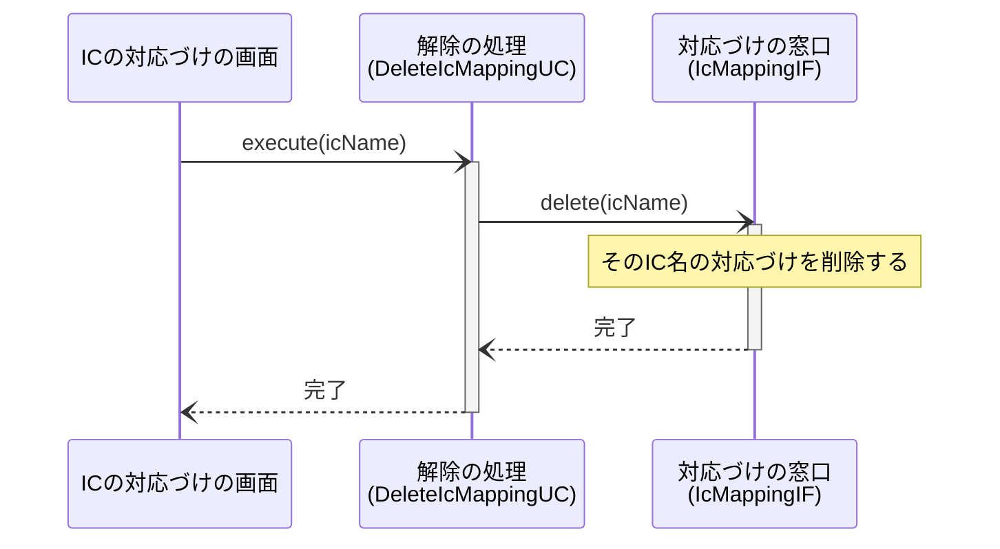

# PRC-008 ICの対応づけの解除（DeleteIcMappingUC）

## 概要

登録した対応づけを、IC名を指定して解除する。

## 実装箇所

| 役割 | ファイル | クラス |
|---|---|---|
| 処理本体 | `lib/application/usecase/ic_mapping/delete_ic_mapping_uc.dart` | `DeleteIcMappingUC` |
| 使う窓口（ICの対応づけ） | `lib/application/interface/ic_mapping_if.dart` | `IcMappingIF`（`delete`） |
| 窓口の実装 | `lib/infrastructure/repository/ic_mapping/ic_mapping_repo.dart` | `IcMappingRepo`（[TBL-002](../tables/TBL-002-ic-mappings.md)） |

## 呼び出し箇所

- [SCR-004](../screens/SCR-004-ic-mapping.md) の OP-4（解除する）が呼び出す

## 入力

| 名前 | 型 | 意味 |
|---|---|---|
| `icName` | `String` | 解除するIC名 |

## 手順

1. `IcMappingIF` の `delete` で、IC名の対応づけを削除する。無いときは、何もしない

## シーケンス図

## 出力

- なし（完了したら戻る）

## エラー時の動作

- 削除に失敗したときは、例外をそのまま呼び出し元に返す。呼び出し元（画面）が ER-3 を表示する

## 関連するテスト

- 単体: `test/application/usecase/ic_mapping/delete_ic_mapping_uc_test.dart`（削除されること、無いIC名でも失敗しないこと、削除の失敗）
