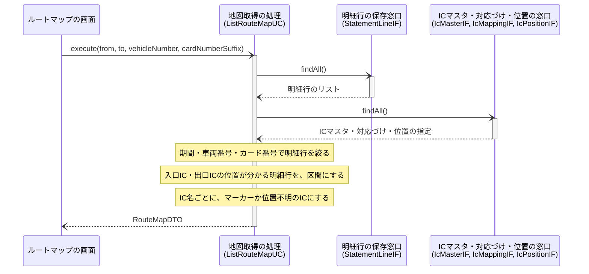

# PRC-009 ルートマップの取得（ListRouteMapUC）

## 概要

保存済みの明細行を絞り込み条件で絞り、地図に描く区間（入口ICから出口ICまで）、IC・料金所のマーカー、位置不明のICを返す。絞り込みの規則は [PRC-004](PRC-004-list-statement-lines.md) と同じ。位置の決め方は [route-map.md](../../route-map.md) の「位置の優先順」に従う。

## 実装箇所

| 役割 | ファイル | クラス |
|---|---|---|
| 処理本体 | `lib/application/usecase/route_map/list_route_map_uc.dart` | `ListRouteMapUC` |
| 結果の受け渡し | `lib/application/dto/route_map_dto.dart` | `RouteMapDTO` |
| 結果の区間 | `lib/application/dto/route_segment_dto.dart` | `RouteSegmentDTO` |
| 結果のマーカー | `lib/application/dto/route_place_dto.dart` | `RoutePlaceDTO` |
| 結果の位置不明のIC | `lib/application/dto/unlocated_ic_dto.dart` | `UnlocatedIcDTO` |
| 使う部品（絞り込み、DTOへの詰め替え） | `lib/application/usecase/statements/statement_filter.dart` | `filterStatementLines`、`toStatementLineDTO` ほか。PRC-004 と共通 |
| 使う部品（IC名の照合、位置の決定） | `lib/application/usecase/ic_mapping/ic_lookup.dart` | `IcLookup`（`placeOf`） |
| 使う部品（線の色） | `lib/application/usecase/route_map/route_runs.dart` | `routeRunsOf` |
| 使う部品（入口が空欄の道路） | `lib/application/usecase/route_map/implied_entrance.dart` | `impliedEntranceNameOf` |
| 使う部品（間の点） | `lib/application/usecase/aggregation/ic_distance.dart` | `IcDistance`（`roadRouteBetween`）、`routeVerticesOf` |
| 使う窓口（明細行） | `lib/application/interface/statement_line_if.dart` | `StatementLineIF`（`findAll`） |
| 使う窓口（ICマスタ） | `lib/application/interface/ic_master_if.dart` | `IcMasterIF`（`findAll`） |
| 使う窓口（ICの対応づけ） | `lib/application/interface/ic_mapping_if.dart` | `IcMappingIF`（`findAll`） |
| 使う窓口（車種区分のマスタ） | `lib/application/interface/vehicle_type_master_if.dart` | `VehicleTypeMasterIF`（`findAll`）。明細行のDTOの車種の名前に使う（PRC-004 と共通） |
| 使う窓口（ICの位置） | `lib/application/interface/ic_position_if.dart` | `IcPositionIF`（`findAll`） |
| 使う窓口（ICのリンク） | `lib/application/interface/ic_master_if.dart` | `IcMasterIF`（`findLinks`） |
| 窓口の実装 | `lib/infrastructure/repository/ic_position/ic_position_repo.dart` | `IcPositionRepo`（[TBL-003](../tables/TBL-003-ic-positions.md)） |

## 呼び出し箇所

- [SCR-005](../screens/SCR-005-route-map.md) の OP-1（地図を表示する）、OP-2（絞り込む）、OP-9（再読み込みする）が呼び出す

## 入力

[PRC-004](PRC-004-list-statement-lines.md) と同じ（`from`、`to`、`vehicleNumber`、`cardNumberSuffix`、`tag`）。

## 手順

1. `StatementLineIF`、`IcMasterIF`、`IcMappingIF`、`IcPositionIF` の `findAll` で、明細行、ICマスタ、対応づけ、位置の指定を取得し、`IcLookup` を作る
2. 絞り込み用の選択肢（車両番号、カード番号の下4桁）を、絞り込む前の全明細行から集める（PRC-004 と同じ）
3. 明細行を絞る（PRC-004 と同じ）
4. 絞った明細行ごとに、入口IC・出口ICの位置を `IcLookup` の `placeOf` で調べる
   - 両方の位置が分かるときは、区間にする（明細行は `StatementLineDTO` にする）。両方がICマスタの地点のときは、最短経路が通る間の地点の位置と、地点の間の道路の形（リンクの `形`）を、順に `via` に入れる（[route-map.md](../../route-map.md) の「地図に描く経路」）。経路が無いとき、位置を利用者が指定したICがあるときは、`via` は空（直線）
   - 入口が空欄のときは、出口が表（安房峠道路の端）に当たるなら、表の入口を入口にして区間にする（[route-map.md](../../route-map.md) の「入口が空欄の明細行の線」）。区間の入口IC名は、その端のIC名
   - 区間には、線を事業者ごとに区切った `runs` も入れる（[route-map.md](../../route-map.md) の「線の色」）
   - 上に当たらない入口の空欄、または、どちらかの位置が分からないときは、区間にしない（「描けない明細行」と数える）
5. 絞った明細行に出てくるIC名（入口が空欄のときは数えない）のうち、位置が分かるものを、マーカーにする。IC名ごとに1つ。そのIC名が出る明細行の数も付ける。位置が分からないものは、位置不明のICにする（明細行の数が多い順、同じなら名前の順）
6. マーカーは、位置の種類（指定、マスタ）と、近似か（マスタの位置で、IC名の末尾が「本線」、または、末尾の上下などを取り除いて一致したもの。`IcLookup` の `placeOf`）を付ける。路線名は、マスタの地点があるときだけ付ける

## シーケンス図

## 出力

`RouteMapDTO`

| 項目 | 型 | 内容 |
|---|---|---|
| `segments` | `List<RouteSegmentDTO>` | 描く区間（絞った明細行の順） |
| `places` | `List<RoutePlaceDTO>` | マーカー（IC名の順） |
| `unlocated` | `List<UnlocatedIcDTO>` | 位置不明のIC |
| `undrawnLineCount` | `int` | 区間にできなかった明細行の数 |
| `vehicleNumberChoices` | `List<int>` | 絞り込みで選べる車両番号 |
| `cardNumberChoices` | `List<String>` | 絞り込みで選べるカード番号（下4桁） |
| `tagChoices` | `List<String>` | 絞り込みで選べるタグ（PRC-004 と同じ） |

`RouteSegmentDTO`: `line`（`StatementLineDTO`）、`fromIcName`、`toIcName`、`fromLatitude`、`fromLongitude`、`toLatitude`、`toLongitude`、`via`（`List<RouteVertexDTO>`。入口から出口までの間の点（間の地点と、道路の形の点）を、順に。`RouteVertexDTO` は `latitude`、`longitude`）、`runs`（`List<RouteRunDTO>`。同じ線を、事業者が変わるところで区切ったもの。`RouteRunDTO` は `operator`（事業者名、不明は「不明」）と `points`（入口側から、終わりまでの点。端を含む。終わりは、次の区間の始まり））

`RoutePlaceDTO`: `icName`、`latitude`、`longitude`、`source`（`IcPlaceSourceValue`: `master`、`specified`）、`approximate`（`bool`）、`routeNames`（`List<String>`）、`lineCount`

`UnlocatedIcDTO`: `icName`、`lineCount`

## エラー時の動作

- 取得に失敗したときは、例外をそのまま呼び出し元に返す。呼び出し元（画面）が ER-1 を表示する

## 関連するテスト

- 単体: `test/application/usecase/route_map/list_route_map_uc_test.dart`（間のICを通る経路と道路の形（`via`）、経路が無いときと位置を指定したときの直線、0件、絞り込み、区間・マーカー・位置不明、入口が空欄の行（IC2つの道路の端は、もう一方の端から描く）、位置の優先順、近似、選択肢が全体から作られること、取得の失敗）
- 単体: `test/application/usecase/route_map/route_runs_test.dart`（事業者が変わるところで色を区切ること、1つの事業者、共通の事業者が無いとき、片方だけ分かるとき、不明、直線、入口と出口が同じ地点、路線の補足）
- ウィジェット: `test/userinterface/route_map/operator_colors_test.dart`（事業者ごとの色、暗いテーマ、不明、区切りの無い線）
- 単体: `test/application/usecase/statements/list_statement_lines_uc_test.dart`（絞り込みを共通の部品にしても、PRC-004 の結果が変わらないこと）
