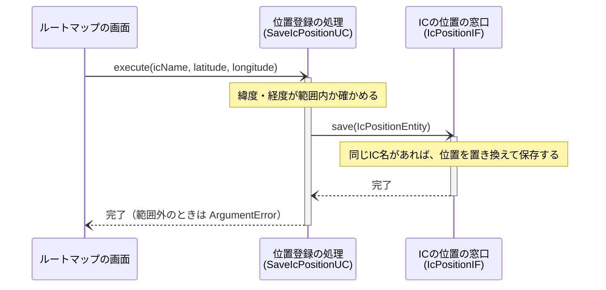

# PRC-010 ICの位置の登録（SaveIcPositionUC）

## 概要

利用者が地図で指定した、IC名の位置を、端末内に登録する。同じIC名があれば、位置を置き換える。

## 実装箇所

| 役割 | ファイル | クラス |
|---|---|---|
| 処理本体 | `lib/application/usecase/route_map/save_ic_position_uc.dart` | `SaveIcPositionUC` |
| 使う窓口（ICの位置） | `lib/application/interface/ic_position_if.dart` | `IcPositionIF`（`save`） |
| 窓口の実装 | `lib/infrastructure/repository/ic_position/ic_position_repo.dart` | `IcPositionRepo`（[TBL-003](../tables/TBL-003-ic-positions.md)） |

## 呼び出し箇所

- [SCR-005](../screens/SCR-005-route-map.md) の OP-5（位置を登録する）が呼び出す

## 入力

| 名前 | 型 | 意味 |
|---|---|---|
| `icName` | `String` | CSVのIC名 |
| `latitude` | `double` | 緯度（度） |
| `longitude` | `double` | 経度（度） |

## 手順

1. 緯度が -90〜90、経度が -180〜180 の範囲か確かめる。範囲外（`NaN` を含む）なら `ArgumentError` を投げる（何も保存しない）
2. `IcPositionIF` の `save` で、IC名と位置を保存する

## シーケンス図

## 出力

- なし（完了したら戻る）

## エラー時の動作

- 範囲外のときは `ArgumentError`。保存に失敗したときは、その例外。呼び出し元（画面）が ER-2 を表示する

## 関連するテスト

- 単体: `test/application/usecase/route_map/list_route_map_uc_test.dart`（保存されること、同じIC名の置き換え、範囲外・NaN のとき保存しないこと、保存の失敗）
