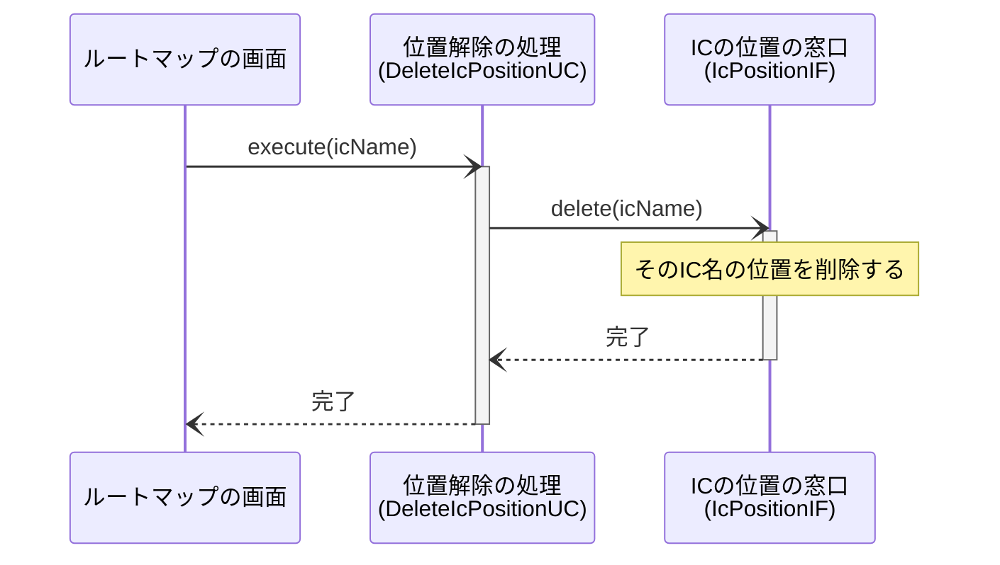

# PRC-011 ICの位置の解除（DeleteIcPositionUC）

## 概要

利用者が指定した、IC名の位置を解除する。解除すると、マスタの位置に戻る。

## 実装箇所

| 役割 | ファイル | クラス |
|---|---|---|
| 処理本体 | `lib/application/usecase/route_map/delete_ic_position_uc.dart` | `DeleteIcPositionUC` |
| 使う窓口（ICの位置） | `lib/application/interface/ic_position_if.dart` | `IcPositionIF`（`delete`） |
| 窓口の実装 | `lib/infrastructure/repository/ic_position/ic_position_repo.dart` | `IcPositionRepo`（[TBL-003](../tables/TBL-003-ic-positions.md)） |

## 呼び出し箇所

- [SCR-005](../screens/SCR-005-route-map.md) の OP-7（マーカーを開く）の、「指定を解除」が呼び出す

## 入力

| 名前 | 型 | 意味 |
|---|---|---|
| `icName` | `String` | 解除するIC名 |

## 手順

1. `IcPositionIF` の `delete` で、IC名の位置を削除する。無いときは、何もしない

## シーケンス図

## 出力

- なし（完了したら戻る）

## エラー時の動作

- 削除に失敗したときは、例外をそのまま呼び出し元に返す。呼び出し元（画面）が ER-3 を表示する

## 関連するテスト

- 単体: `test/application/usecase/route_map/ic_position_uc_test.dart`（削除されること、無いIC名でも失敗しないこと、削除の失敗）
