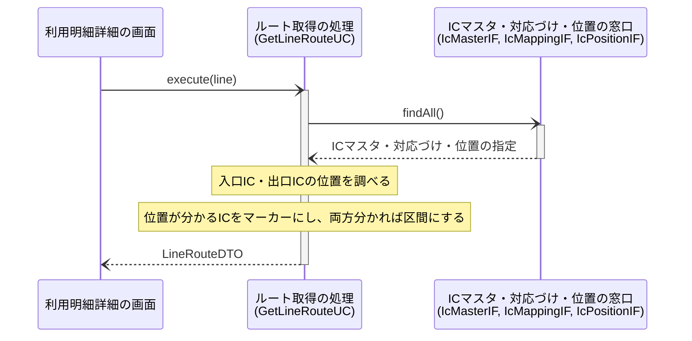

# PRC-012 明細行のルートの取得（GetLineRouteUC）

## 概要

1つの明細行について、地図に描く区間（入口ICから出口ICまで）と、入口・出口のマーカー、位置が分からないIC名を返す。位置の決め方は [PRC-009](PRC-009-list-route-map.md) と同じ（[route-map.md](../../route-map.md) の「位置の優先順」）。

## 実装箇所

| 役割 | ファイル | クラス |
|---|---|---|
| 処理本体 | `lib/application/usecase/route_map/get_line_route_uc.dart` | `GetLineRouteUC` |
| 結果の受け渡し | `lib/application/dto/line_route_dto.dart` | `LineRouteDTO` |
| 結果の区間 | `lib/application/dto/route_segment_dto.dart` | `RouteSegmentDTO`。PRC-009 と共通 |
| 結果のマーカー | `lib/application/dto/route_place_dto.dart` | `RoutePlaceDTO`。PRC-009 と共通 |
| 使う部品（IC名の照合、位置の決定） | `lib/application/usecase/ic_mapping/ic_lookup.dart` | `IcLookup`（`placeOf`） |
| 使う窓口（ICマスタ） | `lib/application/interface/ic_master_if.dart` | `IcMasterIF`（`findAll`、`findLinks`） |
| 使う部品（線の色） | `lib/application/usecase/route_map/route_runs.dart` | `routeRunsOf` |
| 使う部品（入口が空欄の道路） | `lib/application/usecase/route_map/implied_entrance.dart` | `impliedEntranceNameOf` |
| 使う部品（間の点） | `lib/application/usecase/aggregation/ic_distance.dart` | `IcDistance`（`roadRouteBetween`）、`routeVerticesOf` |
| 使う窓口（ICの対応づけ） | `lib/application/interface/ic_mapping_if.dart` | `IcMappingIF`（`findAll`） |
| 使う窓口（ICの位置） | `lib/application/interface/ic_position_if.dart` | `IcPositionIF`（`findAll`） |

## 呼び出し箇所

- [SCR-003](../screens/SCR-003-statement-detail.md) の OP-2（ルートの地図を表示する）が呼び出す

## 入力

| 名前 | 型 | 意味 |
|---|---|---|
| `line` | `StatementLineDTO` | 詳細を表示している明細行 |

## 手順

1. `IcMasterIF`、`IcMappingIF`、`IcPositionIF` の `findAll` で、ICマスタ、対応づけ、位置の指定を取得し、`IcLookup` を作る
2. 入口IC（空欄でなければ）と出口ICの位置を、`IcLookup` の `placeOf` で調べる
3. 位置が分かるICを、マーカーにする（`lineCount` は 1）。位置の種類（指定、マスタ）と近似か、路線名は、PRC-009 と同じ規則で付ける。入口と出口が同じIC名のときは、マーカーは1つ
4. 区間には、PRC-009 と同じく、事業者ごとの `runs` も入れる。入口・出口の両方の位置が分かるときは、区間にする（入口が空欄のときは、PRC-009 と同じく、表に当たる出口なら、表の入口にする）。両方がICマスタの地点のときは、間の地点の位置と、道路の形の点を、順に `via` に入れる（PRC-009 と同じ）。そうでなければ区間にしない
5. 位置が分からないIC名を、`unlocatedIcNames` に入れる（入口、出口の順。同じ名前は1つ）

## シーケンス図

## 出力

`LineRouteDTO`

| 項目 | 型 | 内容 |
|---|---|---|
| `segment` | `RouteSegmentDTO?` | 描く区間。描けないときは `null` |
| `places` | `List<RoutePlaceDTO>` | マーカー（入口、出口の順） |
| `unlocatedIcNames` | `List<String>` | 位置が分からないIC名（入口、出口の順） |

## エラー時の動作

- 取得に失敗したときは、例外をそのまま呼び出し元に返す。呼び出し元（画面）が [SCR-003](../screens/SCR-003-statement-detail.md) の ER-2 を表示する

## 関連するテスト

- 単体: `test/application/usecase/route_map/get_line_route_uc_test.dart`（間のICを通る経路、経路が無いときの直線、区間とマーカー、入口が空欄の行、位置が分からないIC、入口と出口が同じIC名、指定した位置が優先されること、近似、取得の失敗）
- 単体: 線の色の区切りは `test/application/usecase/route_map/route_runs_test.dart`（PRC-009 と共通）
