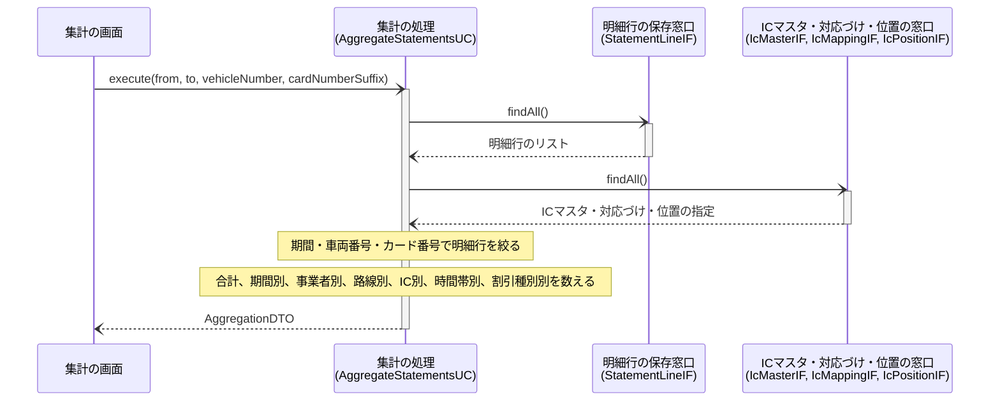

# PRC-013 明細行の集計（AggregateStatementsUC）

## 概要

保存済みの明細行を絞り込み条件で絞り、期間別・事業者別・路線別・IC別・時間帯別・割引種別別の集計と、合計を返す。絞り込みの規則は [PRC-004](PRC-004-list-statement-lines.md) と同じ。集計の定義は [aggregation.md](../../aggregation.md) に従う。

## 実装箇所

| 役割 | ファイル | クラス |
|---|---|---|
| 処理本体 | `lib/application/usecase/aggregation/aggregate_statements_uc.dart` | `AggregateStatementsUC` |
| 結果の受け渡し | `lib/application/dto/aggregation_dto.dart` | `AggregationDTO` |
| 結果の合計 | `lib/application/dto/aggregation_summary_dto.dart` | `AggregationSummaryDTO` |
| 結果の行 | `lib/application/dto/aggregation_row_dto.dart` | `AggregationRowDTO` |
| 使う部品（事業者の推定） | `lib/application/usecase/aggregation/route_operators.dart` | `routeOperatorOf`、`operatorOfRoutes` |
| 使う部品（絞り込み） | `lib/application/usecase/statements/statement_filter.dart` | `filterStatementLines` ほか。PRC-004 と共通 |
| 使う部品（IC名の照合、路線名の決定） | `lib/application/usecase/ic_mapping/ic_lookup.dart` | `IcLookup`（`routeNamesOf`） |
| 使う部品（地点の間の距離） | `lib/application/usecase/aggregation/ic_distance.dart` | `IcDistance`（最短経路。[route-map.md](../../route-map.md) の「地点の間の距離」） |
| 使う窓口 | `StatementLineIF`、`IcMasterIF`、`IcMappingIF`、`IcPositionIF` | 各 `findAll`（`IcMasterIF` は、リンクを返す `findLinks` も使う）。PRC-009 と同じ |

## 呼び出し箇所

- [SCR-006](../screens/SCR-006-aggregation.md) の OP-1（集計を表示する）、OP-2（絞り込む）、OP-7（再読み込みする）が呼び出す

## 入力

[PRC-004](PRC-004-list-statement-lines.md) と同じ（`from`、`to`、`vehicleNumber`、`cardNumberSuffix`、`tag`）。

## 手順

1. `StatementLineIF`、`IcMasterIF`、`IcMappingIF`、`IcPositionIF` の `findAll` で、明細行、ICマスタ、対応づけ、位置の指定を取得し、`IcLookup` を作る
2. 絞り込み用の選択肢を、絞り込む前の全明細行から集める（PRC-004 と同じ）
3. 明細行を絞る（PRC-004 と同じ）
4. 合計（回数、利用額、割引額、距離）を求める。距離は、明細行ごとに [aggregation.md](../../aggregation.md) の「距離の求め方」で決め、分からない明細行は数える
5. 期間別を求める。出口日時の日付から、週（月曜日の日付）・月・年の3通りの行を作る。新しい期間が先
6. 明細行ごとに路線名を `IcLookup` で決め、事業者を `operatorOfRoutes` で決めて、事業者別を求める。利用額の多い順（同額は名前順）
7. 路線別、IC別を求める。回数の多い順（同数は名前順）で、上位10件。上位10件に入らなかった行の回数の合計を、`routesOtherCount`、`icsOtherCount` として添える（円グラフの「その他」用）
8. 時間帯別（出口の時刻の「時」。0〜23のすべて）、割引種別別（回数の多い順、同数は名前順）を求める

## シーケンス図

## 出力

`AggregationDTO`

| 項目 | 型 | 内容 |
|---|---|---|
| `summary` | `AggregationSummaryDTO` | `lineCount`、`fareTotal`、`discountTotal`、`distanceTotal`（メートル）、`distanceUnknownCount`（距離が分からない明細行の数） |
| `weeks`、`months`、`years` | `List<AggregationRowDTO>` | 期間別。`label` は「2026/01/05」（週の月曜日）、「2026/01」、「2026」 |
| `operators` | `List<AggregationRowDTO>` | 事業者別。`label` は事業者名、「複数の事業者」「不明」 |
| `routes` | `List<AggregationRowDTO>` | 路線別（上位10件）。`fare`、`discount` は `null` |
| `ics` | `List<AggregationRowDTO>` | IC別（上位10件）。`fare`、`discount` は `null` |
| `routesOtherCount`、`icsOtherCount` | `int` | 上位10件に入らなかった路線・ICの回数の合計（なければ 0） |
| `hours` | `List<AggregationRowDTO>` | 時間帯別。`label` は「0」〜「23」 |
| `discountTypes` | `List<AggregationRowDTO>` | 割引種別別。`fare` は `null` |
| `vehicleNumberChoices`、`cardNumberChoices`、`tagChoices` | `List<int>`、`List<String>`、`List<String>` | 絞り込みで選べる値 |
| `tags` | `List<AggregationRowDTO>` | タグ別の行（回数、利用額、割引額、距離）。タグが複数ある明細行は、それぞれのタグに入る。タグが無い明細行は、「タグなし」の行に入る。利用額の多い順 |

`AggregationRowDTO`: `label`（`String`）、`count`（`int`）、`fare`（`int?`）、`discount`（`int?`）、`distance`（`int?`。メートル）。`null` は、その集計では出さない値。距離は、期間別・事業者別・時間帯別に付く

## エラー時の動作

- 取得に失敗したときは、例外をそのまま呼び出し元に返す。呼び出し元（画面）が [SCR-006](../screens/SCR-006-aggregation.md) の ER-1 を表示する

## 関連するテスト

- 単体: `test/application/usecase/aggregation/aggregate_statements_uc_test.dart`（0件、合計（距離を含む）、距離が分からない明細行、週・月・年の境界、割引なしの割引額、事業者別（1つ・複数・不明）、路線別・IC別の上位10件と同数の並び、入口が空欄の行、時間帯別が24行そろうこと、割引種別別、絞り込みと選択肢、取得の失敗）
- 単体: `test/application/usecase/aggregation/ic_distance_test.dart`（最短経路、乗り換え、つながらないとき、直線距離への切り替え、同じ地点）
- 単体: `test/application/usecase/aggregation/route_operators_test.dart`（推定の表、複数の事業者、不明）
