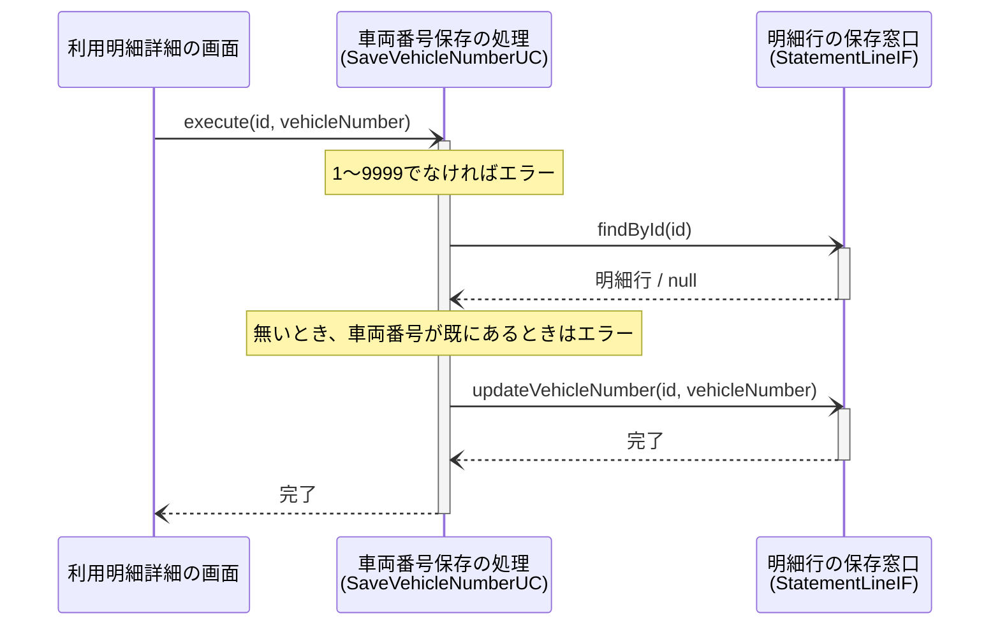

# PRC-014 車両番号の保存（SaveVehicleNumberUC）

## 概要

CSVで車両番号が空欄だった明細行に、利用者が入力した車両番号を保存する。**1回だけ**保存できる。車両番号が既にある明細行は、変更しない。

## 実装箇所

| 役割 | ファイル | クラス |
|---|---|---|
| 処理本体 | `lib/application/usecase/statements/save_vehicle_number_uc.dart` | `SaveVehicleNumberUC` |
| 使う窓口 | `lib/application/interface/statement_line_if.dart` | `StatementLineIF`（`findById`、`updateVehicleNumber`） |
| 窓口の実装 | `lib/infrastructure/repository/statements/statement_line_repo.dart` | `StatementLineRepo`（[TBL-001](../tables/TBL-001-statement-lines.md)） |

## 呼び出し箇所

- [SCR-003](../screens/SCR-003-statement-detail.md) の OP-3（車両番号を入力する）が呼び出す

## 入力

| 名前 | 型 | 意味 |
|---|---|---|
| `id` | `String` | 明細行のID（`StatementLineDTO.id`） |
| `vehicleNumber` | `int` | 入力された車両番号（1〜9999） |

## 手順

1. `vehicleNumber` が 1〜9999 でなければ、`ArgumentError` を投げる（何も保存しない）。0 は車両番号にならない。ナンバープレートの「1〜4桁の数字」に当たる
2. `StatementLineIF` の `findById` で、明細行を探す。見つからなければ、`StateError` を投げる
3. 見つかった明細行に、既に車両番号があれば、`StateError` を投げる（再編集はできない）
4. `StatementLineIF` の `updateVehicleNumber` で、車両番号を保存する

## シーケンス図

## 出力

- なし（完了したら戻る）

## エラー時の動作

- 例外（`ArgumentError`、`StateError`、保存の失敗）を、そのまま呼び出し元に返す。呼び出し元（画面）が ER-3 を表示する。例外のメッセージに、車両番号を含めない（個人情報。[privacy.md](../../privacy.md)）

## 関連するテスト

- 単体: `test/application/usecase/statements/save_vehicle_number_uc_test.dart`（保存されること、範囲の境界（0、1、9999、10000）、見つからないID、既にある車両番号を変えないこと、保存の失敗）
- 単体: `test/application/usecase/settings/import_statement_uc_test.dart`（確認中の行を上書きするとき、入力した車両番号を残すこと）
- 単体: `test/infrastructure/repository/statements/statement_line_repo_test.dart`（`findById`、`updateVehicleNumber`、車両番号なしの保存、版3から版4への移行）
