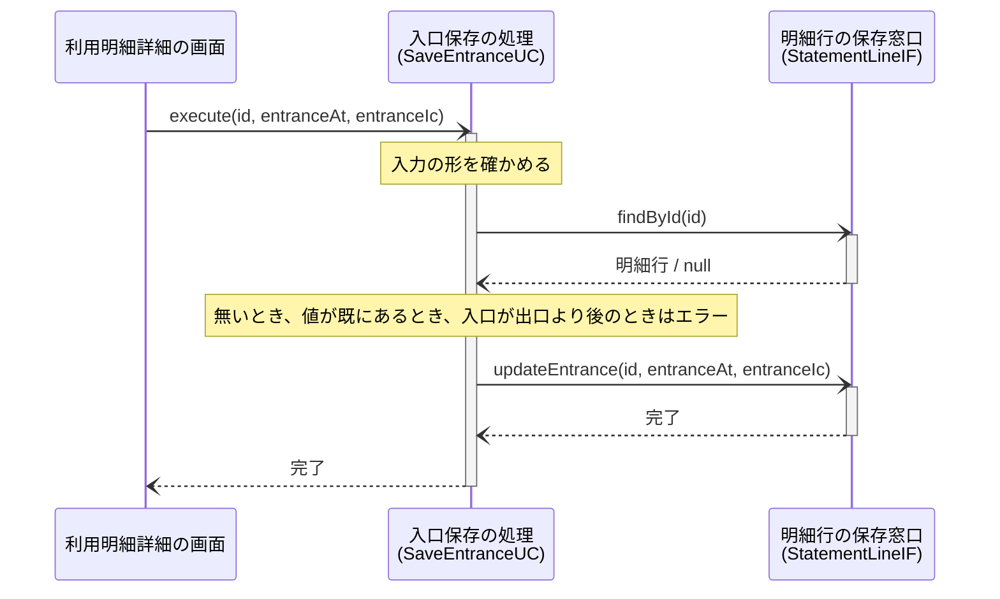

# PRC-015 入口日時・入口ICの保存（SaveEntranceUC）

## 概要

CSVで入口日時・入口ICが空欄だった明細行に、利用者が入力した入口日時・入口ICを保存する。項目ごとに**1回だけ**保存できる。値がある項目は、変更しない。保存した値は、CSVの値とは別に保存し、重複判定のキーは変えない（[csv-format.md](../../csv-format.md)）。

## 実装箇所

| 役割 | ファイル | クラス |
|---|---|---|
| 処理本体 | `lib/application/usecase/statements/save_entrance_uc.dart` | `SaveEntranceUC` |
| 使う窓口 | `lib/application/interface/statement_line_if.dart` | `StatementLineIF`（`findById`、`updateEntrance`） |
| 窓口の実装 | `lib/infrastructure/repository/statements/statement_line_repo.dart` | `StatementLineRepo`（[TBL-001](../tables/TBL-001-statement-lines.md)） |

## 呼び出し箇所

- [SCR-003](../screens/SCR-003-statement-detail.md) の OP-4（入口日時を入力する）、OP-5（入口ICを入力する）が呼び出す

## 入力

| 名前 | 型 | 意味 |
|---|---|---|
| `id` | `String` | 明細行のID（`StatementLineDTO.id`） |
| `entranceAt` | `DateTime?` | 入力された入口日時。入力しない項目は `null` |
| `entranceIc` | `String?` | 入力された入口IC。入力しない項目は `null` |

## 手順

1. `entranceAt` と `entranceIc` の両方が `null` なら、`ArgumentError` を投げる
2. `entranceIc` が空（前後の空白を除いて）なら、`ArgumentError` を投げる
3. `StatementLineIF` の `findById` で、明細行を探す。見つからなければ、`StateError` を投げる
4. `entranceAt` がある場合: 明細行の入口日時が既にあれば、`StateError` を投げる。出口日時より後なら、`ArgumentError` を投げる（入口は出口より前）
5. `entranceIc` がある場合: 明細行の入口ICが既にあれば、`StateError` を投げる
6. 何も投げなかったときだけ、`StatementLineIF` の `updateEntrance` で保存する（片方だけの失敗で、もう片方だけ保存することは無い）

## シーケンス図

## 出力

- なし（完了したら戻る）

## エラー時の動作

- 例外（`ArgumentError`、`StateError`、保存の失敗）を、そのまま呼び出し元に返す。呼び出し元（画面）が ER-3 を表示する。例外のメッセージに、入力した値を含めない（[privacy.md](../../privacy.md)）

## 関連するテスト

- 単体: `test/application/usecase/statements/save_entrance_uc_test.dart`（日時だけ、ICだけ、両方、入力なし、空のIC、入口が出口より後、既にある値を変えないこと、見つからないID、保存の失敗）
- 単体: `test/infrastructure/repository/statements/statement_line_repo_test.dart`（入力した値が別に保存されること、CSVの値が優先されること、上書きで残ること、重複判定のキーが変わらないこと）
