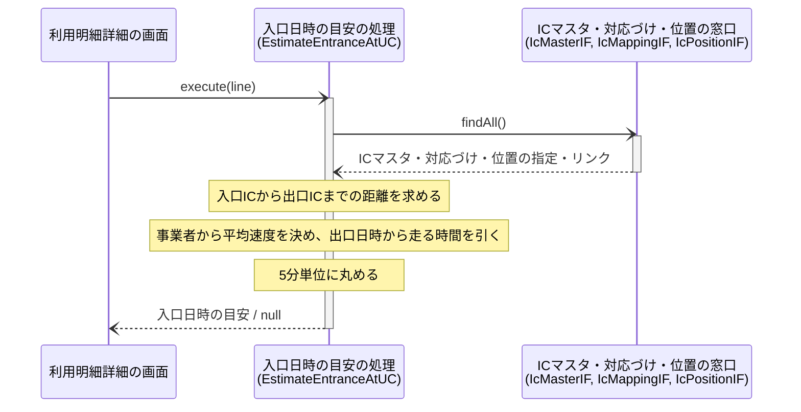

# PRC-016 入口日時の目安の計算（EstimateEntranceAtUC）

## 概要

入口日時を入力するときの初期値にする、入口日時の目安を計算する。**出口日時から、入口ICから出口ICまでの距離を平均速度で走る時間を引いた日時**を、5分単位に丸める。入口ICが空欄のとき、距離が分からないときは、目安は無い（`null`）。

## 実装箇所

| 役割 | ファイル | クラス |
|---|---|---|
| 処理本体 | `lib/application/usecase/statements/estimate_entrance_at_uc.dart` | `EstimateEntranceAtUC` |
| 使う部品（明細行の距離） | `lib/application/usecase/aggregation/ic_distance.dart` | `lineMeters`、`IcDistance`。[PRC-013](PRC-013-aggregate-statements.md) と共通（[aggregation.md](../../aggregation.md) の「距離の求め方」） |
| 使う部品（事業者の推定） | `lib/application/usecase/aggregation/route_operators.dart` | `operatorOfRoutes`、`isUrbanOperator` |
| 使う部品（IC名の照合、路線名の決定） | `lib/application/usecase/ic_mapping/ic_lookup.dart` | `IcLookup` |
| 使う窓口 | `IcMasterIF`、`IcMappingIF`、`IcPositionIF` | 各 `findAll`（`IcMasterIF` は `findLinks` も）。PRC-012 と同じ |

## 呼び出し箇所

- [SCR-003](../screens/SCR-003-statement-detail.md) の OP-4（入口日時を入力する）が、日付と時分を選ぶ前に呼び出す

## 入力

| 名前 | 型 | 意味 |
|---|---|---|
| `line` | `StatementLineDTO` | 詳細を表示している明細行（入口日時が空欄のもの） |

## 手順

1. 入口ICが空欄なら、`null` を返す
2. `IcMasterIF`、`IcMappingIF`、`IcPositionIF` から、`IcLookup` と `IcDistance` を作る
3. 入口ICから出口ICまでの距離（メートル）を、PRC-013 と同じ規則（`lineMeters`）で求める。分からなければ、`null` を返す
4. 平均速度を決める
   - 明細行の事業者（路線名から推定。[aggregation.md](../../aggregation.md) の「道路事業者の推定」）が、**都市高速**（首都高速道路、阪神高速道路、名古屋高速道路公社、福岡北九州高速道路公社、広島高速道路公社）のときは、**60km/h**
   - それ以外（NEXCO、複数の事業者にまたがるとき、不明のとき）は、**80km/h**
5. 走る時間 = 距離 ÷ 平均速度 を求め、出口日時から引く
6. 5分単位に丸める（2分までは切り捨て、3分からは切り上げ。秒は、30秒以上を1分に数える）
7. 丸めた日時が出口日時より後になったとき（距離がほぼ0のとき）は、出口日時を返す

例: 距離40km、NEXCO（80km/h）→ 30分。出口が 09:15 なら、08:45。

## シーケンス図

## 出力

- `DateTime?`（入口日時の目安。無いときは `null`）

## エラー時の動作

- 例外を、そのまま呼び出し元に返す。呼び出し元（画面）は、失敗したときは目安を使わず、出口日時を初期値にする（入力の操作は止めない）

## 関連するテスト

- 単体: `test/application/usecase/statements/estimate_entrance_at_uc_test.dart`（80km/h、都市高速60km/h、複数の事業者、5分への丸め、日をまたぐ、出口より後にならないこと、入口ICが空欄・距離が分からないとき `null`、入力した位置の直線距離、失敗）
