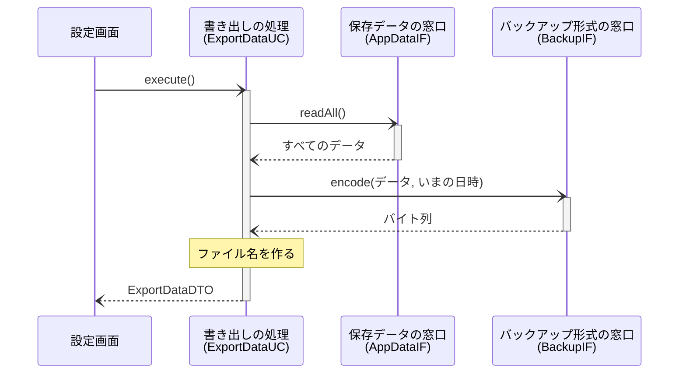

# PRC-017 データの書き出し（ExportDataUC）

## 概要

端末内に保存したすべてのデータ（明細行、ICの対応づけ、ICの位置の指定、事業者の線の色、地図の表示の選択）を、バックアップファイルの内容（バイト列）と、ファイル名にして返す。ファイルの形式は [backup-format.md](../../backup-format.md)。ファイルへの保存は、画面側の処理（Userinterface）で、この処理は行わない。

## 実装箇所

| 役割 | ファイル | クラス |
|---|---|---|
| 処理本体 | `lib/application/usecase/settings/export_data_uc.dart` | `ExportDataUC` |
| 結果の受け渡し | `lib/application/dto/export_data_dto.dart`、`lib/application/dto/data_summary_dto.dart` | `ExportDataDTO`（ファイル名、バイト列、件数）、`DataSummaryDTO`（明細行・対応づけ・位置の件数） |
| 使う窓口（保存済みのデータ） | `lib/application/interface/app_data_if.dart` | `AppDataIF`（`readAll`） |
| 使う窓口（ファイルの形式） | `lib/application/interface/backup_if.dart` | `BackupIF`（`encode`） |
| 窓口の実装 | `lib/infrastructure/repository/settings/app_data_repo.dart`、`backup_repo.dart` | `AppDataRepo`、`BackupRepo` |

## 呼び出し箇所

- [SCR-001](../screens/SCR-001-settings.md) の OP-4（データを書き出す）が呼び出す

## 入力

- なし

## 手順

1. `AppDataIF` の `readAll` で、すべてのデータを読む
2. `BackupIF` の `encode` で、バックアップファイルの内容にする（書き出した日時を添える）
3. ファイル名を、いまの日時から作る（`etc-meisai-backup-年月日-時分.json`）
4. バイト列、ファイル名、件数を、`ExportDataDTO` にして返す

## シーケンス図

## 出力

`ExportDataDTO`: `fileName`（`String`）、`bytes`（`Uint8List`）、`summary`（`DataSummaryDTO`: `lineCount`、`mappingCount`、`positionCount`）

## エラー時の動作

- 読み込みに失敗したときは、例外をそのまま呼び出し元に返す。呼び出し元（画面）が ER-4 を表示する

## 関連するテスト

- 単体: `test/application/usecase/settings/data_backup_uc_test.dart`（書き出し: 件数、ファイル名、データが空のとき、失敗）
- 単体: `test/infrastructure/repository/settings/backup_repo_test.dart`、`app_data_repo_test.dart`
