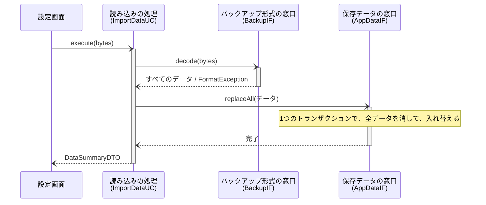

# PRC-018 データの読み込み（ImportDataUC）

## 概要

バックアップファイルの内容を読み、端末内のすべてのデータ（明細行、ICの対応づけ、ICの位置の指定、事業者の線の色、地図の表示の選択、地図の数値）を、**その内容で置き換える**。取り込みのように、ファイルの内容を足したり、上書きの規則（確定・確認中）を適用したりはしない。いまのデータは、すべて消える。

確認のダイアログ（元に戻せないこと）は、画面側（[SCR-001](../screens/SCR-001-settings.md)）で出す。ファイルの形式は [backup-format.md](../../backup-format.md)。

## 実装箇所

| 役割 | ファイル | クラス |
|---|---|---|
| 処理本体 | `lib/application/usecase/settings/import_data_uc.dart` | `ImportDataUC` |
| 結果の受け渡し | `lib/application/dto/data_summary_dto.dart` | `DataSummaryDTO`（読み込んだ件数） |
| 使う窓口（保存済みのデータ） | `lib/application/interface/app_data_if.dart` | `AppDataIF`（`replaceAll`） |
| 使う窓口（ファイルの形式） | `lib/application/interface/backup_if.dart` | `BackupIF`（`decode`） |
| 窓口の実装 | `lib/infrastructure/repository/settings/app_data_repo.dart`、`backup_repo.dart` | `AppDataRepo`、`BackupRepo` |

## 呼び出し箇所

- [SCR-001](../screens/SCR-001-settings.md) の OP-5（データを読み込む）が、確認ダイアログで「置き換える」を選び、ファイルを選んだあとに呼び出す

## 入力

- バックアップファイルのバイト列（`Uint8List`）

## 手順

1. `BackupIF` の `decode` で、バイト列をデータに変える。形式が合わなければ、`FormatException` を投げる（[backup-format.md](../../backup-format.md) の「読み込みの検査」）。この時点では、何も変えない
2. `AppDataIF` の `replaceAll` で、いまのデータをすべて消し、読み込んだデータに置き換える。**1つのトランザクションで行い、途中で失敗したら、元のデータに戻る**
3. 読み込んだ件数を、`DataSummaryDTO` にして返す

## シーケンス図

## 出力

`DataSummaryDTO`: `lineCount`、`mappingCount`、`positionCount`

## エラー時の動作

- ファイルの形式が合わないときは、何が不正かを示す `FormatException` を投げる。メッセージにファイルの値は含めない。**何も置き換えない**。呼び出し元（画面）が ER-5 を表示する
- 保存の途中で失敗したときは、例外をそのまま返す。トランザクションなので、元のデータのまま。呼び出し元（画面）が ER-6 を表示する

## 関連するテスト

- 単体: `test/application/usecase/settings/data_backup_uc_test.dart`（読み込み: 置き換わること、件数、形式が不正なとき何も変えないこと、保存の失敗）
- 単体: `test/infrastructure/repository/settings/app_data_repo_test.dart`（全置き換え、途中の失敗で元に戻ること）、`backup_repo_test.dart`（形式の検査）
- 結合: `integration_test/data_backup_test.dart`（書き出して、全削除して、読み込むと、元と同じになること）
