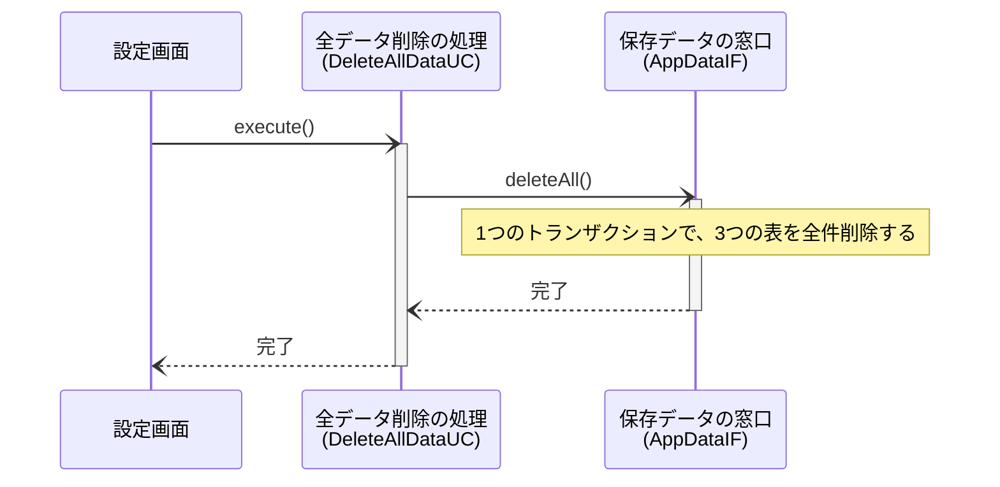

# PRC-019 すべてのデータの削除（DeleteAllDataUC）

## 概要

端末内に保存したすべてのデータ（明細行、ICの対応づけ、ICの位置の指定、事業者の線の色）を、削除する。[PRC-003](PRC-003-delete-all-statement-lines.md)（取り込んだ明細行だけの削除）とは別で、対応づけと位置の指定も消す。

## 実装箇所

| 役割 | ファイル | クラス |
|---|---|---|
| 処理本体 | `lib/application/usecase/settings/delete_all_data_uc.dart` | `DeleteAllDataUC` |
| 使う窓口（保存済みのデータ） | `lib/application/interface/app_data_if.dart` | `AppDataIF`（`deleteAll`） |
| 窓口の実装 | `lib/infrastructure/repository/settings/app_data_repo.dart` | `AppDataRepo` |

## 呼び出し箇所

- [SCR-001](../screens/SCR-001-settings.md) の OP-6（すべてのデータを削除する）が、確認ダイアログで「削除する」を選んだあとに呼び出す

## 入力

- なし

## 手順

1. `AppDataIF` の `deleteAll` を呼ぶ。明細行・ICの対応づけ・ICの位置の指定・事業者の線の色を、**1つのトランザクションで**すべて削除する（途中で失敗したら、元のデータのまま）

## シーケンス図

## 出力

- なし（完了したら戻る）

## エラー時の動作

- 失敗したときは、例外をそのまま呼び出し元に返す。呼び出し元（画面）が ER-7 を表示する

## 関連するテスト

- 単体: `test/application/usecase/settings/data_backup_uc_test.dart`（全データの削除、失敗）
- 単体: `test/infrastructure/repository/settings/app_data_repo_test.dart`（3つの表がすべて空になること、途中の失敗で元に戻ること）
