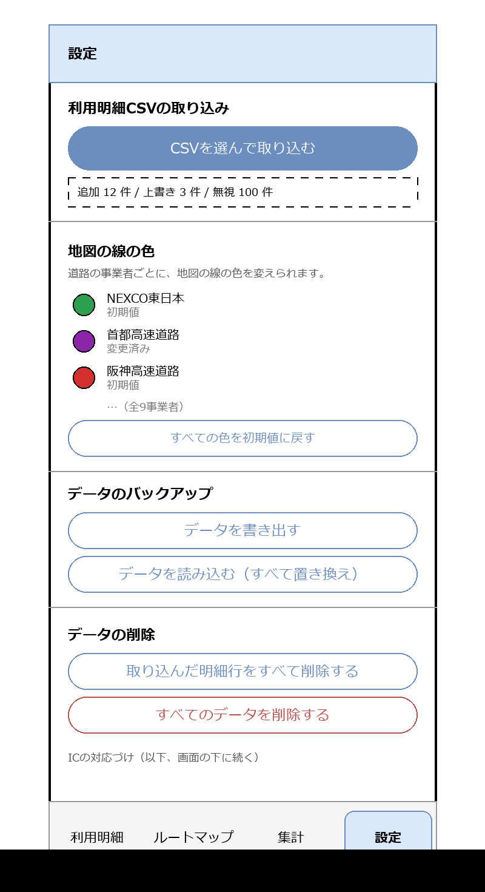
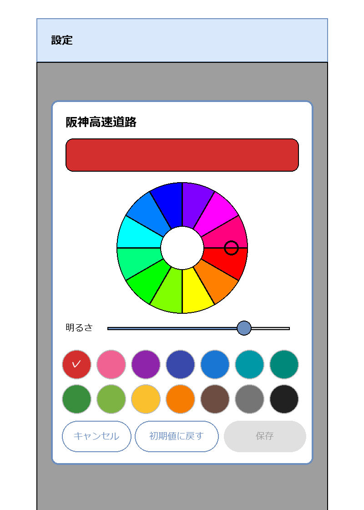
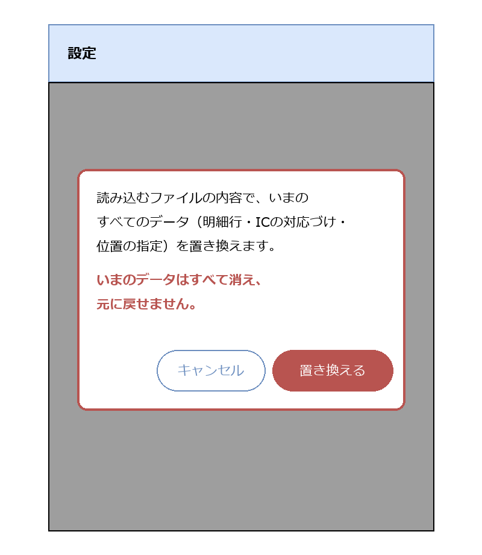

# SCR-001 設定

## 概要

利用明細CSVの取り込み、地図の線の色の変更、データのバックアップ（書き出し・読み込み）、データの削除を行う画面（[specification.md](../../specification.md) の 3.3）。

## 実装箇所

| 役割 | ファイル | クラス |
|---|---|---|
| 画面 | `lib/userinterface/settings/settings_screen.dart` | `SettingsScreen` |
| 画面の状態と操作 | `lib/userinterface/settings/settings_controller.dart` | `SettingsController`、`SettingsState` |
| 画面の文言 | `lib/userinterface/settings/settings_strings.dart` | `SettingsStrings`（出典の文を含む） |
| ファイル選択 | `lib/userinterface/settings/csv_picker.dart` | `CsvPicker`（関数の型）、`pickCsv` |
| バックアップのファイル選択・保存 | `lib/userinterface/settings/backup_files.dart` | `BackupPicker`、`BackupSaver`（関数の型）、`pickBackup`、`saveBackup` |
| 地図の線の色 | `lib/userinterface/settings/operator_color_section.dart` | `OperatorColorSection`、`showOperatorColorDialog` |
| 線の色の受け口 | `lib/userinterface/route_map/operator_color_providers.dart` | `operatorColorsProvider`、各 `Provider`（地図も同じ色を使う） |
| 共通のウィジェット | `lib/userinterface/common/section_title.dart`、`message_text.dart`、`confirm_dialog.dart` | `SectionTitle`、`MessageText`、`showConfirmDialog` |
| 依存の受け口 | `lib/userinterface/settings/settings_providers.dart` | 各 `Provider`（実体は `lib/main.dart` で渡す） |

## 呼び出し箇所

- ルート `/settings`（`lib/userinterface/app.dart` の `GoRouter`）。下部のナビゲーションバーの「設定」で表示する（起動時に表示するのは [SCR-002](SCR-002-statement-list.md)）

## 基本設計

### 画面イメージ

画面イメージは draw.io で描く。画像（PNG）に draw.io のデータを埋め込んであるので、draw.io で開いて編集できる。

画面は縦にスクロールする。画像は、画面の上のほう（出典の表示は、いちばん下にある）。

事業者の線の色を決めるダイアログ（色環とパレット）:

データを読み込むときの、確認のダイアログ（注意）:

破線の枠は、状況によって表示する項目（処理中の進捗表示、取り込み結果、取り込みエラー、書き出し・読み込み・削除の結果）。

### 入出力項目一覧

| 項目 | 入力/出力 | 型 | 表示形式 |
|---|---|---|---|
| 取り込みボタン | 入力 | ボタン | 「CSVを選んで取り込む」。処理中は押せない |
| 取り込み結果 | 出力 | `ImportResultDTO` | 「追加 N 件 / 上書き N 件 / 無視 N 件」。まだ取り込んでいないときは表示しない |
| 取り込みエラー | 出力 | 文字列 | 「取り込めませんでした: 」に、不正な箇所の説明を続ける（[PRC-002](../processes/PRC-002-parse-statement.md) のエラー）。無いときは表示しない |
| 事業者ごとの線の色 | 入力 | 一覧（9事業者） | 「地図の線の色」の節。事業者ごとに、色の見本（丸）、事業者名、「初期値」または「変更済み」。タップすると、色の変更（OP-7）を開く。読み込み中は進捗、読み込みに失敗したときは ER-8 |
| 色の変更 | 入力 | ダイアログ | 事業者名、いまの色の見本、色環（タップ・ドラッグで色相と彩度を決める。決めた位置に印を出す）、明るさのスライダー、パレット（14色の丸。同じ色にチェックを付ける。名前は長押しで表示）、「キャンセル」「初期値に戻す」「保存」。初期値のときは「初期値に戻す」を押せない。いまの色から変えていないときは「保存」を押せない |
| すべての色を初期値に戻すボタン | 入力 | ボタン | 「すべての色を初期値に戻す」。変更済みの色が無いときは押せない |
| 書き出しボタン | 入力 | ボタン | 「データを書き出す」。処理中は押せない。下に、「書き出したファイルには、車両番号とETCカード番号が含まれます。保管に注意してください。」 |
| 読み込みボタン | 入力 | ボタン | 「データを読み込む（すべて置き換え）」。処理中は押せない |
| 読み込みの確認 | 入力 | ダイアログ（注意） | 「読み込むファイルの内容で、いまのすべてのデータ（明細行・ICの対応づけ・位置の指定・線の色）を置き換えます。いまのデータはすべて消え、元に戻せません。」と、「キャンセル」「置き換える」 |
| 書き出し・読み込みの結果 | 出力 | 文字列 | 「書き出しました（明細行 N 件 / 対応づけ N 件 / 位置の指定 N 件）」「読み込みました（同じ形式）」。まだ行っていないときは表示しない |
| 書き出し・読み込みのエラー | 出力 | 文字列 | ER-4〜ER-6。無いときは表示しない |
| 明細行の削除ボタン | 入力 | ボタン | 「取り込んだ明細行をすべて削除する」。処理中は押せない |
| 明細行の削除の確認 | 入力 | ダイアログ | 「取り込んだデータをすべて削除します。元に戻せません。」と、「キャンセル」「削除する」 |
| 全データの削除ボタン | 入力 | ボタン | 「すべてのデータを削除する」。処理中は押せない |
| 全データの削除の確認 | 入力 | ダイアログ（注意） | 「すべてのデータ（明細行・ICの対応づけ・位置の指定）を削除します。元に戻せません。」と、「キャンセル」「削除する」 |
| ICの対応づけを開くボタン | 入力 | ボタン | 「ICの対応づけを開く」 |
| ICマスタの出典 | 出力 | 文字列 | 「出典：国土交通省 国土数値情報（高速道路時系列データ）（URL）を加工して作成」と、「一部の料金所・出入口の位置：© OpenStreetMap contributors（ODbL）」。画面の下部に、常に表示する |
| 処理中の表示 | 出力 | 進捗の表示 | 取り込み・書き出し・読み込み・削除の間、表示する |

### 操作一覧

| 操作ID | 操作 | きっかけ | 動作 | 遷移先 |
|---|---|---|---|---|
| OP-1 | CSVを取り込む | 取り込みボタンのタップ | ファイル選択（端末の標準画面）を開き、選んだCSVを取り込む。選ばなかったときは何もしない。完了したら、取り込み結果を表示し、[SCR-002](SCR-002-statement-list.md) の一覧を更新させる（`dataRevisionProvider`） | なし |
| OP-2 | データを削除する | 削除ボタンのタップ | 確認ダイアログを出す。「削除する」を選んだら、すべて削除し、「削除しました」を表示し、[SCR-002](SCR-002-statement-list.md) の一覧を更新させる。「キャンセル」なら何もしない | なし |
| OP-3 | ICの対応づけを開く | 「ICの対応づけを開く」のタップ | ICの対応づけの画面を表示する | [SCR-004](SCR-004-ic-mapping.md) |
| OP-4 | データを書き出す | 書き出しボタンのタップ | バックアップの内容を作り（[PRC-017](../processes/PRC-017-export-data.md)）、保存先の選択（端末の標準画面）を開いて、ファイルに保存する。選ばなかったときは、何も保存せず、メッセージも出さない。保存できたら、結果を表示する | なし |
| OP-5 | データを読み込む | 読み込みボタンのタップ | 確認のダイアログを出す。「置き換える」を選んだら、ファイル選択（端末の標準画面）を開き、選んだファイルで、すべてのデータを置き換える（[PRC-018](../processes/PRC-018-import-data.md)）。「キャンセル」、またはファイルを選ばなかったときは、何もしない。完了したら、結果を表示し、一覧・ルートマップ・集計を更新させる（`dataRevisionProvider`） | なし |
| OP-6 | すべてのデータを削除する | 全データの削除ボタンのタップ | 確認のダイアログを出す。「削除する」を選んだら、明細行・ICの対応づけ・ICの位置の指定をすべて削除し（[PRC-019](../processes/PRC-019-delete-all-data.md)）、「すべてのデータを削除しました」を表示し、一覧・ルートマップ・集計を更新させる。「キャンセル」なら何もしない | なし |
| OP-7 | 事業者の線の色を選ぶ | 事業者の行のタップ | 色の変更のダイアログを開く。色環・明るさ・パレットのどれかで色を決め、「保存」を押すと、保存する（[PRC-022](../processes/PRC-022-save-operator-color.md)）。「キャンセル」なら何もしない。保存したら、一覧の見本と、地図の線の色が変わる | なし |
| OP-8 | 事業者の線の色を初期値に戻す | 色の変更のダイアログの「初期値に戻す」のタップ | その事業者の色を取り消す（[PRC-023](../processes/PRC-023-reset-operator-colors.md)）。初期値の色になる | なし |
| OP-9 | すべての線の色を初期値に戻す | 「すべての色を初期値に戻す」のタップ | すべての事業者の色を取り消す（PRC-023）。確認のダイアログは出さない（色は、選び直せるため） | なし |

### エラー一覧

| ID | 発生する場面 | 表示する文言（文字列定数） | 操作の続け方 |
|---|---|---|---|
| ER-1 | OP-1 で、CSVの形式が不正（[PRC-002](../processes/PRC-002-parse-statement.md) の `FormatException`） | `SettingsStrings.importFailed(message)` | 既存のデータは変わらない。CSVを直して、もう一度取り込む |
| ER-2 | OP-1 で、形式以外の失敗（保存の失敗など） | `SettingsStrings.importUnexpected` | 保存の途中で失敗すると、一部だけ取り込まれていることがある。もう一度取り込めば、同じ明細行は重複しない。直らないときは、データを削除して取り込み直す |
| ER-3 | OP-2 で、削除に失敗 | `SettingsStrings.deleteFailed` | もう一度削除する |
| ER-4 | OP-4 で、書き出しに失敗（データの読み込みの失敗、ファイルへの保存の失敗） | `SettingsStrings.exportFailed` | もう一度書き出す |
| ER-5 | OP-5 で、ファイルの形式が合わない（[PRC-018](../processes/PRC-018-import-data.md) の `FormatException`） | `SettingsStrings.restoreFailed(message)`（「読み込めませんでした: 」に、不正な箇所の説明を続ける） | **データは、変わっていない**。正しいバックアップのファイルを選んで、もう一度読み込む |
| ER-6 | OP-5 で、形式以外の失敗（保存の失敗など） | `SettingsStrings.restoreUnexpected` | **データは、変わっていない**（トランザクション）。もう一度読み込む |
| ER-7 | OP-6 で、削除に失敗 | `SettingsStrings.deleteAllFailed` | データは、変わっていない。もう一度削除する |
| ER-8 | 線の色の読み込みに失敗（[PRC-021](../processes/PRC-021-list-operator-colors.md)） | `SettingsStrings.operatorColorLoadFailed`（節の中に表示する） | 地図は、初期値の色で描く。設定を開き直す |
| ER-9 | OP-7〜OP-9 で、保存・削除に失敗 | `SettingsStrings.operatorColorSaveFailed`（画面下のメッセージ） | もう一度行う。失敗の詳細は出さない |

- 結果とエラーは、押したボタンの下に出す（取り込みはCSVの取り込みの節、書き出し・読み込みはデータのバックアップの節、削除は削除の節）。画面が長いので、押した場所から離れた所に出さない
- ER-2〜ER-4、ER-6、ER-7 には、失敗の詳細（例外の内容）を出さない。個人情報が含まれることがあるため（[privacy.md](../../privacy.md)）

## 詳細設計

### 画面から呼ばれる処理

シーケンス図は、各処理の設計書に書く。

| 操作ID | 呼ぶ処理 | 設計書 |
|---|---|---|
| OP-1 | 利用明細CSVの取込（`ImportStatementUC`） | [PRC-001](../processes/PRC-001-import-statement.md) |
| OP-2 | 取り込んだ明細行の全削除（`DeleteAllStatementLinesUC`） | [PRC-003](../processes/PRC-003-delete-all-statement-lines.md) |
| OP-4 | データの書き出し（`ExportDataUC`） | [PRC-017](../processes/PRC-017-export-data.md) |
| OP-5 | データの読み込み（`ImportDataUC`） | [PRC-018](../processes/PRC-018-import-data.md) |
| OP-6 | すべてのデータの削除（`DeleteAllDataUC`） | [PRC-019](../processes/PRC-019-delete-all-data.md) |
| 色の表示 | 事業者の線の色の取得（`ListOperatorColorsUC`） | [PRC-021](../processes/PRC-021-list-operator-colors.md) |
| OP-7 | 事業者の線の色の保存（`SaveOperatorColorUC`） | [PRC-022](../processes/PRC-022-save-operator-color.md) |
| OP-8・OP-9 | 事業者の線の色の初期値への復帰（`ResetOperatorColorsUC`） | [PRC-023](../processes/PRC-023-reset-operator-colors.md) |

- ファイル選択と、ファイルへの保存は、画面側の処理（Userinterface）で、業務の処理ではない。選んだファイルのバイト列だけを、処理に渡し、処理が返したバイト列だけを、保存する
- 画面は `StatementLineEntity` を扱わない。結果は `ImportResultDTO`、`ExportDataDTO`、`DataSummaryDTO` で受け取る

## 関連するテスト

- ウィジェット: `test/userinterface/settings/settings_screen_test.dart`（初期表示、取り込み結果、取り込みエラー、キャンセル、削除の確認、処理中、出典の表示、ICの対応づけの画面へ移ること、書き出し（保存先を選ばないとき、ER-4）、読み込み（確認、キャンセル、ファイルを選ばないとき、ER-5、ER-6）、すべてのデータの削除（確認、ER-7））
- 結合: `integration_test/settings_import_test.dart`（画面からDBまで、`lib/main.dart` と同じ組み立てで実行する。ファイル選択だけを差し替える。架空のCSV（`test/fixtures/statement_fixture.dart`）を取り込むと「追加 3 件」、もう一度取り込むと「上書き 1 件・無視 2 件」、削除するともう一度「追加 3 件」になること。形式が不正なCSVは、エラーを表示して、何も保存しないこと）
- 結合: `integration_test/data_backup_test.dart`（書き出して、全削除して、読み込むと、元と同じになること。形式が不正なファイルは、何も変えないこと。すべてのデータの削除）
- ウィジェット: `test/userinterface/settings/operator_color_section_test.dart`（事業者の一覧と初期値、色環・明るさ・パレットで選んで保存、キャンセル、1事業者と全事業者の初期値への復帰、保存と読み込みの失敗）
- 単体: `test/application/usecase/settings/delete_all_statement_lines_uc_test.dart`（PRC-003）、`test/userinterface/settings/settings_controller_test.dart`（画面の状態と操作、一覧の更新通知）
