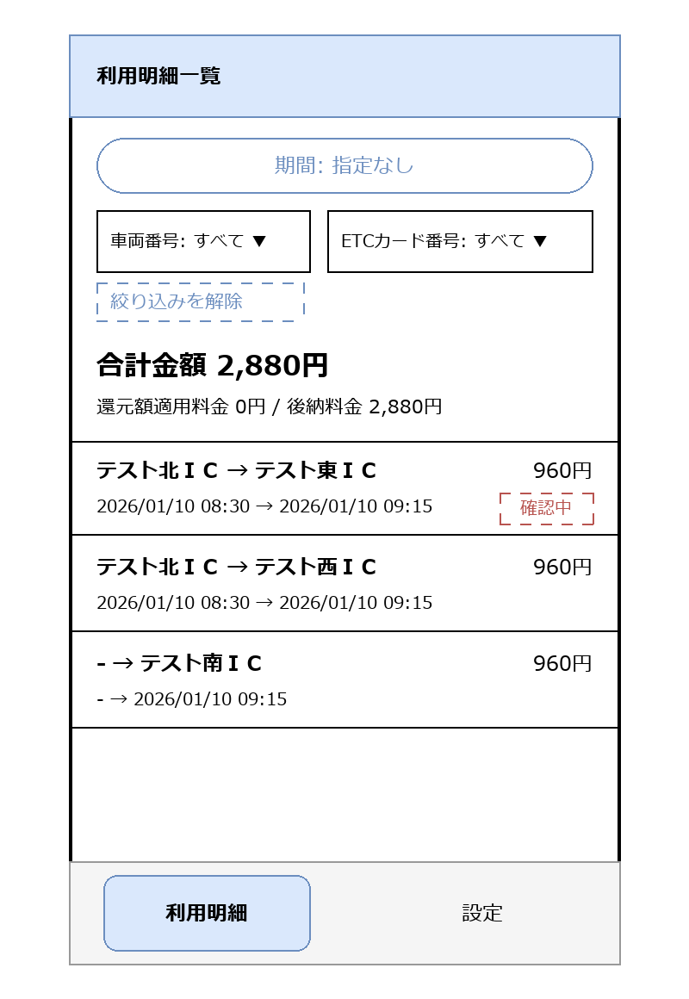

# SCR-002 利用明細一覧

## 概要

取り込んだ明細行を一覧で確認する画面（[specification.md](../../specification.md) の 3.1）。期間・車両番号・ETCカード番号で絞り込み、合計金額を表示する。

## 実装箇所

| 役割 | ファイル | クラス |
|---|---|---|
| 画面 | `lib/userinterface/statements/statement_list_screen.dart` | `StatementListScreen` |
| 画面の状態と操作 | `lib/userinterface/statements/statement_list_controller.dart` | `StatementFilterState`、`StatementFilterController`、`statementListProvider` |
| 画面の文言 | `lib/userinterface/statements/statement_list_strings.dart` | `StatementListStrings` |
| 依存の受け口 | `lib/userinterface/statements/statement_list_providers.dart` | `listStatementLinesUCProvider`（実体は `lib/main.dart` で渡す） |
| 取り込み・削除のあとの更新 | `lib/userinterface/common/data_revision.dart` | `dataRevisionProvider` |
| 金額・日時の表示形式 | `lib/userinterface/common/format.dart` | `formatYen`、`formatDateTime` |
| 画面の切り替え | `lib/userinterface/app_shell.dart` | `AppShell`（下部のナビゲーションバー） |

## 呼び出し箇所

- ルート `/statements`（`lib/userinterface/app.dart` の `GoRouter`）。起動時に表示する
- 下部のナビゲーションバーの「利用明細」

## 基本設計

### 画面イメージ

破線の枠は、状況によって表示する項目（絞り込みの解除、確認中の表示）。

### 入出力項目一覧

| 項目 | 入力/出力 | 型 | 表示形式 |
|---|---|---|---|
| 期間 | 入力 | ボタン（日付範囲の選択） | 「2026/01/01 〜 2026/01/31」。指定がないときは「指定なし」 |
| 車両番号 | 入力 | 選択（`vehicleNumberChoices`） | 先頭は「すべて」。続けて、取り込み済みの車両番号 |
| ETCカード番号 | 入力 | 選択（`cardNumberChoices`） | 先頭は「すべて」。続けて「**** 0001」の形（下4桁のみ） |
| 絞り込みの解除 | 入力 | ボタン | 「絞り込みを解除」。条件を1つでも指定しているときだけ表示する |
| 合計金額 | 出力 | `StatementListDTO.totalFare` | 「合計金額 1,234円」 |
| 合計の内訳 | 出力 | `totalFareAfterRebate`、`totalPostpaidFare` | 「還元額適用料金 0円 / 後納料金 1,234円」 |
| 入口・出口のIC | 出力 | `entranceIc`、`exitIc` | 「入口IC → 出口IC」。入口が空欄のときは「- → 出口IC」 |
| 入口・出口の日時 | 出力 | `entranceAt`、`exitAt` | 「2026/01/10 08:30 → 2026/01/10 09:15」。入口が空欄のときは「- → …」 |
| 通行料金 | 出力 | `StatementLineDTO.fare` | 「960円」 |
| 状態 | 出力 | `StatementLineDTO.status` | 確認中の明細行にだけ「確認中」を表示する。確定は表示しない |
| 処理中の表示 | 出力 | 進捗の表示 | 読み込み中は、進捗バーを表示する |

- 並び順は、出口日時の新しい順
- 一覧が0件のときは、一覧の代わりに文言を表示する（取り込み済みの明細行が無いとき: 「取り込んだ明細行がありません」。絞り込みで0件のとき: 「条件に合う明細行がありません」）。0件のときも、合計金額は「0円」で表示する

### 操作一覧

| 操作ID | 操作 | きっかけ | 動作 | 遷移先 |
|---|---|---|---|---|
| OP-1 | 一覧を表示する | 画面を開く、または、CSVの取り込み・全削除が終わる | 条件なしで明細行を読み込み、一覧と合計金額を表示する。CSVの取り込み・全削除のあとは、いま指定している条件のまま、読み込み直す | なし |
| OP-2 | 絞り込む | 期間・車両番号・ETCカード番号の選択 | 指定した条件で、一覧と合計金額を読み込み直す。条件は、指定したものすべてを満たす明細行に絞る | なし |
| OP-3 | 絞り込みを解除する | 解除ボタンのタップ | すべての条件を外して、読み込み直す | なし |
| OP-4 | 再読み込みする | 再読み込みボタンのタップ（ER-1 のとき） | 現在の条件で、読み込み直す | なし |
| OP-5 | 設定へ移る | ナビゲーションバーの「設定」 | 設定画面を表示する | [SCR-001](SCR-001-settings.md) |

### エラー一覧

| ID | 発生する場面 | 表示する文言（文字列定数） | 操作の続け方 |
|---|---|---|---|
| ER-1 | OP-1、OP-2、OP-3 で、明細行の読み込みに失敗 | `StatementListStrings.loadFailed` | OP-4 で、もう一度読み込む |

- ER-1 には、失敗の詳細（例外の内容）を出さない。個人情報が含まれることがあるため（[privacy.md](../../privacy.md)）

## 詳細設計

### 画面から呼ばれる処理

シーケンス図は、各処理の設計書に書く。

| 操作ID | 呼ぶ処理 | 設計書 |
|---|---|---|
| OP-1、OP-2、OP-3、OP-4 | 明細行の一覧の取得（`ListStatementLinesUC`） | [PRC-004](../processes/PRC-004-list-statement-lines.md) |

- 画面は `StatementLineEntity` を扱わない。結果は `StatementListDTO` で受け取る
- ETCカード番号は、処理が下4桁にして返す。画面は、元の番号を持たない
- 取り込み・全削除（[SCR-001](SCR-001-settings.md)）が終わると、設定画面が `dataRevisionProvider` を更新する。一覧の画面は、この更新と絞り込み条件の変更を見て、読み込み直す

## 関連するテスト

- ウィジェット: `test/userinterface/statements/statement_list_screen_test.dart`（一覧の表示項目、確認中の表示、入口が空欄の行、合計と内訳、0件の2種類の文言、絞り込みの操作と解除、読み込み中、ER-1と再読み込み）
- ウィジェット: `test/userinterface/app_shell_test.dart`（起動時に一覧が出ること、ナビゲーションバーで設定と一覧を切り替えられること）
- 結合: `integration_test/statement_list_test.dart`（画面からDBまで。設定画面でCSVを取り込むと、一覧に3件と合計が出ること。全削除すると、一覧が空になること）
- 単体: `test/userinterface/common/format_test.dart`（金額・日時の表示形式）
