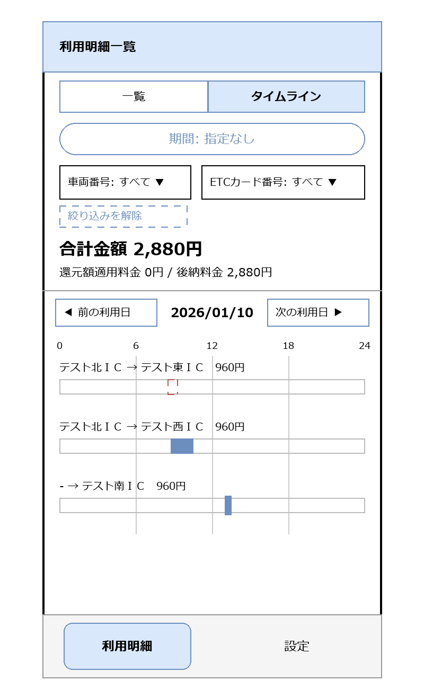

# SCR-002 利用明細一覧

## 概要

取り込んだ明細行を、一覧またはタイムラインで確認する画面（[specification.md](../../specification.md) の 3.1）。期間・車両番号・ETCカード番号で絞り込み、合計金額を表示する。明細行をタップすると、詳細（[SCR-003](SCR-003-statement-detail.md)）へ移る。

## 実装箇所

| 役割 | ファイル | クラス |
|---|---|---|
| 画面（絞り込み・合計・一覧） | `lib/userinterface/statements/statement_list_screen.dart` | `StatementListScreen` |
| タイムラインの表示 | `lib/userinterface/statements/statement_timeline.dart` | `StatementTimeline` |
| 画面の状態と操作 | `lib/userinterface/statements/statement_list_controller.dart` | `StatementFilterState`、`StatementFilterController`、`StatementListModeController`、`TimelineDayController`、`statementListProvider` |
| 画面の文言 | `lib/userinterface/statements/statement_list_strings.dart` | `StatementListStrings` |
| 依存の受け口 | `lib/userinterface/statements/statement_list_providers.dart` | `listStatementLinesUCProvider`（実体は `lib/main.dart` で渡す） |
| 取り込み・削除のあとの更新 | `lib/userinterface/common/data_revision.dart` | `dataRevisionProvider` |
| 金額・日時の表示形式 | `lib/userinterface/common/format.dart` | `formatYen`、`formatDate`、`formatDateTime` |
| 画面の切り替え | `lib/userinterface/app_shell.dart` | `AppShell`（下部のナビゲーションバー） |

## 呼び出し箇所

- ルート `/statements`（`lib/userinterface/app.dart` の `GoRouter`）。起動時に表示する
- 下部のナビゲーションバーの「利用明細」
- [SCR-003](SCR-003-statement-detail.md) の戻るボタン

## 基本設計

### 画面イメージ

一覧の表示:

タイムラインの表示:

破線の枠は、状況によって表示する項目（絞り込みの解除、確認中の表示、割引種別）。

### 入出力項目一覧

| 項目 | 入力/出力 | 型 | 表示形式 |
|---|---|---|---|
| 表示の切り替え | 入力 | 切り替えボタン | 「一覧」「タイムライン」の2つ。起動時は「一覧」 |
| 期間 | 入力 | ボタン（日付範囲の選択） | 「期間: 2026/01/01 〜 2026/01/31」。指定がないときは「期間: 指定なし」 |
| 車両番号 | 入力 | 選択（`vehicleNumberChoices`） | 先頭は「すべて」。続けて、取り込み済みの車両番号 |
| ETCカード番号 | 入力 | 選択（`cardNumberChoices`） | 先頭は「すべて」。続けて「**** 0001」の形（下4桁のみ） |
| 絞り込みの解除 | 入力 | ボタン | 「絞り込みを解除」。条件を1つでも指定しているときだけ表示する |
| 合計金額 | 出力 | `StatementListDTO.totalFare` | 「合計金額 1,234円」 |
| 合計の内訳 | 出力 | `totalFareAfterRebate`、`totalPostpaidFare` | 「還元額適用料金 0円 / 後納料金 1,234円」 |
| 入口・出口のIC（一覧） | 出力 | `entranceIc`、`exitIc` | 「入口IC → 出口IC」。入口が空欄のときは「- → 出口IC」 |
| 入口・出口の日時（一覧） | 出力 | `entranceAt`、`exitAt` | 「2026/01/10 08:30 → 2026/01/10 09:15」。入口が空欄のときは「- → …」 |
| 通行料金 | 出力 | `StatementLineDTO.fare` | 「960円」 |
| 状態 | 出力 | `StatementLineDTO.status` | 確認中の明細行にだけ「確認中」を表示する。確定は表示しない |
| 割引種別 | 出力 | `StatementLineDTO.discountTypes` | 割引種別が1つ以上あるときだけ、「深夜割引・休日割引」のように「・」でつないで表示する |
| 表示する日（タイムライン） | 出力 | 日付 | 「2026/01/10」。最初は、絞り込み後の最新の利用日 |
| 前の利用日・次の利用日（タイムライン） | 入力 | ボタン2つ | 表示中の日の前後で、明細行がある日へ移る。無いときは押せない |
| 時間軸（タイムライン） | 出力 | 目盛り | 0・6・12・18・24 時。縦の補助線を引く |
| 帯（タイムライン） | 出力 | 入口日時〜出口日時 | 明細行1件につき1行。帯の上に「入口IC → 出口IC」と通行料金を表示する。入口が空欄のときは、出口の時刻に小さな印だけを表示する。日をまたぐときは、その日の範囲だけ描く。確認中は、塗りつぶさず枠だけで描く |
| 処理中の表示 | 出力 | 進捗の表示 | 読み込み中は、進捗バーを表示する |

- 並び順は、一覧では出口日時の新しい順、タイムラインでは入口時刻（入口が空欄のときは出口時刻）の早い順
- 一覧が0件のときは、一覧またはタイムラインの代わりに文言を表示する（取り込み済みの明細行が無いとき: 「取り込んだ明細行がありません」。絞り込みで0件のとき: 「条件に合う明細行がありません」）。0件のときも、合計金額は「0円」で表示する
- 表示中の日に明細行が無くなったとき（絞り込みを変えたときなど）は、絞り込み後の最新の利用日を表示する
- 絞り込みと合計金額は、一覧とタイムラインで共通。切り替えても、条件は保たれる

### 操作一覧

| 操作ID | 操作 | きっかけ | 動作 | 遷移先 |
|---|---|---|---|---|
| OP-1 | 一覧を表示する | 画面を開く、または、CSVの取り込み・全削除が終わる | 条件なしで明細行を読み込み、一覧と合計金額を表示する。CSVの取り込み・全削除のあとは、いま指定している条件のまま、読み込み直す | なし |
| OP-2 | 絞り込む | 期間・車両番号・ETCカード番号の選択 | 指定した条件で、一覧と合計金額を読み込み直す。条件は、指定したものすべてを満たす明細行に絞る | なし |
| OP-3 | 絞り込みを解除する | 解除ボタンのタップ | すべての条件を外して、読み込み直す | なし |
| OP-4 | 再読み込みする | 再読み込みボタンのタップ（ER-1 のとき） | 現在の条件で、読み込み直す | なし |
| OP-5 | 設定へ移る | ナビゲーションバーの「設定」 | 設定画面を表示する | [SCR-001](SCR-001-settings.md) |
| OP-6 | 表示を切り替える | 「一覧」「タイムライン」のタップ | 同じ明細行を、選んだ表示にする。読み込み直さない | なし |
| OP-7 | 表示する日を移す | 前の利用日・次の利用日のタップ（タイムライン） | 表示する日を、明細行がある前の日・次の日にする。読み込み直さない | なし |
| OP-8 | 詳細を開く | 一覧の行、またはタイムラインの帯のタップ | その明細行の詳細を表示する | [SCR-003](SCR-003-statement-detail.md) |

### エラー一覧

| ID | 発生する場面 | 表示する文言（文字列定数） | 操作の続け方 |
|---|---|---|---|
| ER-1 | OP-1、OP-2、OP-3 で、明細行の読み込みに失敗 | `StatementListStrings.loadFailed` | OP-4 で、もう一度読み込む |

- ER-1 には、失敗の詳細（例外の内容）を出さない。個人情報が含まれることがあるため（[privacy.md](../../privacy.md)）

## 詳細設計

### 画面から呼ばれる処理

シーケンス図は、各処理の設計書に書く。

| 操作ID | 呼ぶ処理 | 設計書 |
|---|---|---|
| OP-1、OP-2、OP-3、OP-4 | 明細行の一覧の取得（`ListStatementLinesUC`） | [PRC-004](../processes/PRC-004-list-statement-lines.md) |

- OP-6、OP-7、OP-8 は、画面の中で完結する（処理を呼ばない）。タイムラインの帯の位置は、`StatementLineDTO` の日時から、画面が計算する（業務の判断ではなく、描画のための計算）
- 画面は `StatementLineEntity` を扱わない。結果は `StatementListDTO` で受け取る
- ETCカード番号は、処理が下4桁にして返す。画面は、元の番号を持たない
- 取り込み・全削除（[SCR-001](SCR-001-settings.md)）が終わると、設定画面が `dataRevisionProvider` を更新する。一覧の画面は、この更新と絞り込み条件の変更を見て、読み込み直す
- OP-8 は、タップした明細行の `StatementLineDTO` を、ルート `/statements/detail` に渡して開く

## 関連するテスト

- ウィジェット: `test/userinterface/statements/statement_list_screen_test.dart`（一覧の表示項目、確認中と割引種別の表示、入口が空欄の行、合計と内訳、0件の2種類の文言、絞り込みの操作と解除、読み込み中、ER-1と再読み込み、詳細へ移ること）
- ウィジェット: `test/userinterface/statements/statement_timeline_test.dart`（表示の切り替え、帯の並びと位置、確認中・入口が空欄・日またぎの帯、前後の利用日への移動、絞り込みでの日の戻し、帯のタップで詳細へ移ること）
- ウィジェット: `test/userinterface/app_shell_test.dart`（起動時に一覧が出ること、ナビゲーションバーで設定と一覧を切り替えられること）
- 結合: `integration_test/statement_list_test.dart`（画面からDBまで。設定画面でCSVを取り込むと、一覧に3件と合計が出ること。タイムライン、詳細を開けること。全削除すると、一覧が空になること）
- 単体: `test/userinterface/common/format_test.dart`（金額・日時の表示形式）
