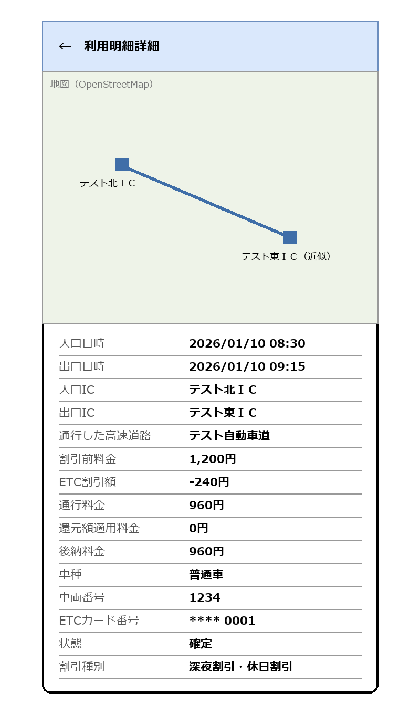

# SCR-003 利用明細詳細

## 概要

選んだ明細行の、すべての項目を表示する画面（[specification.md](../../specification.md) の 3.4）。

## 実装箇所

| 役割 | ファイル | クラス |
|---|---|---|
| 画面 | `lib/userinterface/statements/statement_detail_screen.dart` | `StatementDetailScreen` |
| 画面の文言 | `lib/userinterface/statements/statement_detail_strings.dart` | `StatementDetailStrings` |
| 金額・日時の表示形式 | `lib/userinterface/common/format.dart` | `formatYen`、`formatDateTime` |
| ルートの地図 | `lib/userinterface/statements/line_route_map.dart` | `LineRouteMap` |
| 使う処理の受け口 | `lib/userinterface/statements/statement_detail_providers.dart` | `getLineRouteUCProvider`、`lineRouteProvider` |

## 呼び出し箇所

- ルート `/statements/detail`（`lib/userinterface/app.dart` の `GoRouter`）。[SCR-002](SCR-002-statement-list.md) の OP-8 が、明細行（`StatementLineDTO`）を渡して開く。[SCR-005](SCR-005-route-map.md) の OP-8 は、同じ画面を `/route-map/detail` で開く

## 基本設計

### 画面イメージ

### 入出力項目一覧

すべて出力。値は、渡された `StatementLineDTO` から表示する。ルートの地図だけは、[PRC-012](../processes/PRC-012-get-line-route.md) で取得する。

| 項目 | 型 | 表示形式 |
|---|---|---|
| ルートの地図 | `LineRouteDTO` | 項目の上に、高さ約240の地図。入口ICから出口ICまでの線（確定は実線、確認中は破線）と、入口・出口のマーカー（IC名。近似のときは「IC名（近似）」）を描き、2つのマーカーが収まるように表示する。地図の動かし方は、ピンチで拡大・縮小、ドラッグで移動。位置が分からないICがあるときは、地図の上に「位置が分からないICがあります: IC名」を示す。マーカーが1つも無いときは、地図を表示しない |
| 入口日時 | `entranceAt` | 「2026/01/10 08:30」。空欄のときは「-」 |
| 出口日時 | `exitAt` | 「2026/01/10 09:15」 |
| 入口IC | `entranceIc` | 空欄のときは「-」 |
| 出口IC | `exitIc` | IC名 |
| 通行した高速道路 | `routeNames` | 「東名高速道路・首都高速道路」のように「・」でつなぐ。無いときは「-」 |
| 割引前料金 | `grossFare` | 「1,200円」。`null`（割引なし）のときは「-」 |
| ETC割引額 | `etcDiscount` | 「-240円」。`null`（割引なし）のときは「-」 |
| 通行料金 | `fare` | 「960円」 |
| 還元額適用料金 | `fareAfterRebate` | 「0円」 |
| 後納料金 | `postpaidFare` | 「960円」 |
| 車種 | `vehicleType` | 名前（普通車など） |
| 車両番号 | `vehicleNumber` | 数字（個人情報） |
| ETCカード番号 | `cardNumberSuffix` | 「**** 0001」（下4桁のみ） |
| 状態 | `status` | 「確定」または「確認中」 |
| 割引種別 | `discountTypes` | 「深夜割引・休日割引」のように「・」でつなぐ。無いときは「なし」 |

- 通行した高速道路（路線名）の決め方は、[route-map.md](../../route-map.md) の「路線名」に従う。決められないときは、[SCR-004](SCR-004-ic-mapping.md) で対応づけを登録すると、表示される

### 操作一覧

| 操作ID | 操作 | きっかけ | 動作 | 遷移先 |
|---|---|---|---|---|
| OP-1 | 戻る | 戻るボタン（画面上部、または端末の戻る操作） | 元の表示（一覧またはタイムライン）に戻る。絞り込みなどの状態は保たれる | [SCR-002](SCR-002-statement-list.md) |
| OP-2 | ルートの地図を表示する | 画面を開く | 渡された明細行のルート（区間、マーカー、位置が分からないIC）を取得し、地図に描く。取得中は、地図の場所に読み込み中の表示を出す。ほかの項目は、取得を待たずに表示する | なし |

### エラー一覧

| ID | 発生する場面 | 表示する文言（文字列定数） | 操作の続け方 |
|---|---|---|---|
| ER-1 | 明細行が渡されずに開かれた（アプリの再起動後に、この画面の位置が復元されたときなど） | `StatementDetailStrings.notFound` | OP-1 で戻る |
| ER-2 | OP-2 で、ルートの取得に失敗 | `StatementDetailStrings.routeLoadFailed`（地図の場所に表示する。失敗の詳細は出さない） | ほかの項目は、そのまま見られる。画面を開き直すと、もう一度取得する |

## 詳細設計

- 項目の値は、SCR-002 または [SCR-005](SCR-005-route-map.md) から渡された `StatementLineDTO` を使う
- ルートの地図は、`GetLineRouteUC`（[PRC-012](../processes/PRC-012-get-line-route.md)）で取得する。地図の描き方（OpenStreetMapの地図、線の太さと色、マーカー、出典の表示）は、SCR-005 と同じ。SCR-005 と違い、線やマーカーのタップ、位置の指定はできない（位置の指定は SCR-005 で行う）
- 地図の取得は、ほかの項目の表示を止めない。ER-2 のときも、ほかの項目は表示する
- 車両番号とETCカード番号は個人情報。画面には出すが、ログには出さない（[privacy.md](../../privacy.md)）

## 関連するテスト

- 単体: `test/application/usecase/route_map/get_line_route_uc_test.dart`（PRC-012）
- ウィジェット: `test/userinterface/statements/statement_detail_screen_test.dart`（ルートの地図（線・マーカー、確認中の破線、位置が分からないICの表示、入口が空欄、マーカーが無いとき地図が出ないこと、読み込み中、ER-2）、すべての項目（路線名を含む）の表示、空欄・`null`・路線名なしの項目が「-」になること、割引種別が無いとき「なし」、確認中、明細行が渡されないときのER-1、戻るボタン）
- 結合: `integration_test/statement_list_test.dart`（一覧から詳細を開け、ルートの地図が出ること）
