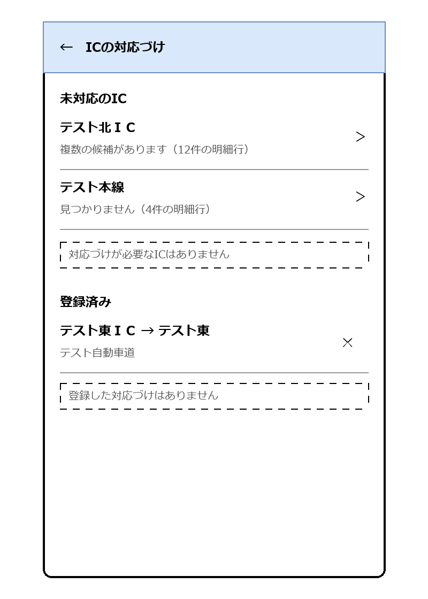
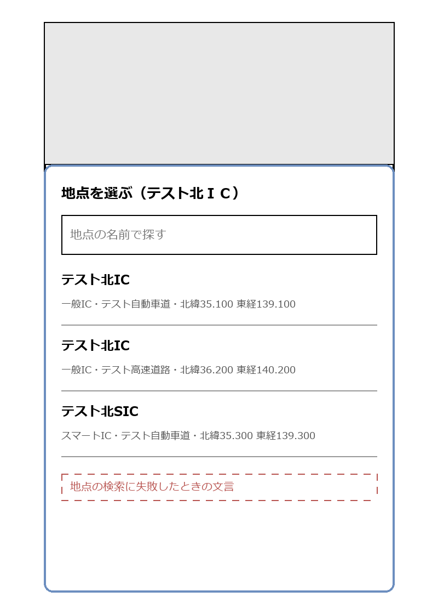

# SCR-004 ICの対応づけ

## 概要

CSVのIC名を、ICマスタの地点に結びつける画面（[specification.md](../../specification.md) の 3.5）。自動で一つに決まらないIC名（複数候補、未一致）を一覧し、利用者が地点を探して選び、対応づけを登録する。登録済みの対応づけを解除することもできる。

## 実装箇所

| 役割 | ファイル | クラス |
|---|---|---|
| 画面 | `lib/userinterface/ic_mapping/ic_mapping_screen.dart` | `IcMappingScreen` |
| 地点を選ぶシート | `lib/userinterface/ic_mapping/ic_point_picker.dart` | `IcPointPicker`（画面下から出るシート） |
| 画面の状態と操作 | `lib/userinterface/ic_mapping/ic_mapping_controller.dart` | `icMatchListProvider`、`icPointSearchProvider`、`IcMappingActions` |
| 画面の文言 | `lib/userinterface/ic_mapping/ic_mapping_strings.dart` | `IcMappingStrings` |
| 依存の受け口 | `lib/userinterface/ic_mapping/ic_mapping_providers.dart` | 各 `Provider`（実体は `lib/main.dart` で渡す） |
| 更新の通知 | `lib/userinterface/common/data_revision.dart` | `dataRevisionProvider` |

## 呼び出し箇所

- ルート `/settings/ic-mapping`（`lib/userinterface/app.dart` の `GoRouter`）。[SCR-001](SCR-001-settings.md) の OP-3 から開く

## 基本設計

### 画面イメージ

画面:

地点を選ぶシート:

### 入出力項目一覧

| 項目 | 入力/出力 | 型 | 表示形式 |
|---|---|---|---|
| 未対応のIC | 出力 | `IcMatchListDTO.unresolved` | 行ごとに、IC名と、「複数の候補があります」または「見つかりません」と、「N件の明細行」。タップできる |
| 登録済みの対応づけ | 出力 | `IcMatchListDTO.registered` | 行ごとに、「IC名 → 地点名」と、路線名（「・」でつなぐ）。地点がマスタに無いときは「地点が見つかりません」 |
| 解除ボタン | 入力 | アイコンボタン | 登録済みの行の右端。タップで解除する |
| 探す文字（シート） | 入力 | 文字入力 | 「地点の名前で探す」。空欄のときは、複数候補の候補を表示し、未一致のときは何も表示しない |
| 地点の一覧（シート） | 出力 | `IcPointDTO` のリスト | 行ごとに、地点名と、種類（一般IC・スマートIC・JCT・その他）、路線名、緯度経度（「北緯35.123 東経139.456」）。タップできる |
| 処理中の表示 | 出力 | 進捗の表示 | 読み込み中は、進捗バーを表示する |

- 未対応のICが無いときは、「対応づけが必要なICはありません」を表示する
- 登録済みが無いときは、「登録した対応づけはありません」を表示する
- 未対応のICは、明細行の数が多い順に並べる

### 操作一覧

| 操作ID | 操作 | きっかけ | 動作 | 遷移先 |
|---|---|---|---|---|
| OP-1 | 一覧を表示する | 画面を開く、または、登録・解除が終わる | 未対応のICと、登録済みの対応づけを読み込んで表示する | なし |
| OP-2 | 地点を探す | 未対応のICのタップ、シートの文字入力 | 地点を選ぶシートを開く。文字を入力すると、その名前を含む地点を探して表示する | なし |
| OP-3 | 地点を選んで登録する | シートの地点のタップ | そのIC名に、選んだ地点を登録し、シートを閉じて、一覧を読み込み直す。一覧・詳細の路線名も更新させる（`dataRevisionProvider`） | なし |
| OP-4 | 解除する | 登録済みの行の解除ボタンのタップ | その対応づけを解除し、一覧を読み込み直す。一覧・詳細の路線名も更新させる | なし |
| OP-5 | 戻る | 戻るボタン | [SCR-001](SCR-001-settings.md) に戻る | SCR-001 |

### エラー一覧

| ID | 発生する場面 | 表示する文言（文字列定数） | 操作の続け方 |
|---|---|---|---|
| ER-1 | OP-1 で、読み込みに失敗 | `IcMappingStrings.loadFailed` | 「再読み込み」で、もう一度読み込む |
| ER-2 | OP-2 で、地点の検索に失敗 | `IcMappingStrings.searchFailed` | 文字を変えて、もう一度探す |
| ER-3 | OP-3、OP-4 で、登録・解除に失敗 | `IcMappingStrings.saveFailed`（登録）、`IcMappingStrings.deleteFailed`（解除）。画面下のメッセージで表示する | もう一度操作する |

- ER-1〜3 には、失敗の詳細（例外の内容）を出さない。個人情報が含まれることがあるため（[privacy.md](../../privacy.md)）

## 詳細設計

### 画面から呼ばれる処理

シーケンス図は、各処理の設計書に書く。

| 操作ID | 呼ぶ処理 | 設計書 |
|---|---|---|
| OP-1 | IC名の一致状態の一覧の取得（`ListIcMatchesUC`） | [PRC-005](../processes/PRC-005-list-ic-matches.md) |
| OP-2 | IC地点の検索（`SearchIcPointsUC`） | [PRC-006](../processes/PRC-006-search-ic-points.md) |
| OP-3 | ICの対応づけの登録（`SaveIcMappingUC`） | [PRC-007](../processes/PRC-007-save-ic-mapping.md) |
| OP-4 | ICの対応づけの解除（`DeleteIcMappingUC`） | [PRC-008](../processes/PRC-008-delete-ic-mapping.md) |

- 画面は `IcPointEntity` を扱わない。結果は `IcMatchListDTO`、`IcPointDTO` で受け取る
- 登録・解除のあとは、`dataRevisionProvider` を更新する。[SCR-002](SCR-002-statement-list.md) の一覧は、この更新を見て、路線名を読み込み直す

## 関連するテスト

- ウィジェット: `test/userinterface/ic_mapping/ic_mapping_screen_test.dart`（未対応と登録済みの表示、空のときの文言、複数候補の候補表示、未一致の検索、地点を選んでの登録、解除、読み込み中、ER-1〜3）
- 結合: `integration_test/ic_mapping_test.dart`（画面からDBまで。登録すると一覧の路線名が変わること、解除すると戻ること）
