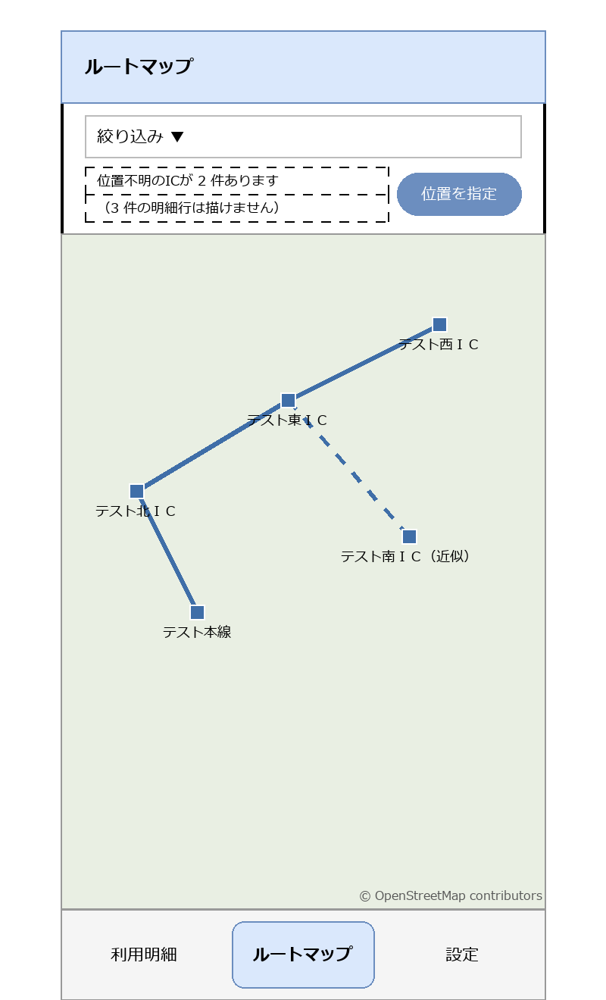
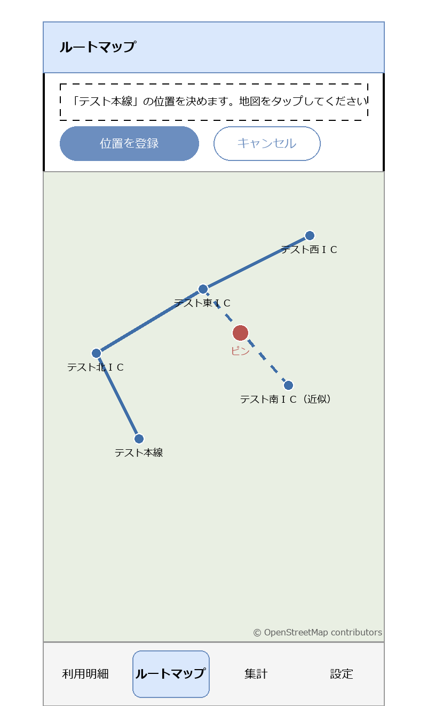

# SCR-005 ルートマップ

## 概要

期間の全明細行のルートを、地図上に描く画面（[specification.md](../../specification.md) の 3.2）。位置が分からないICは描かずに通知し、利用者が地図をタップして位置を指定できる。IC・料金所の位置を直すこともできる。

## 実装箇所

| 役割 | ファイル | クラス |
|---|---|---|
| 画面 | `lib/userinterface/route_map/route_map_screen.dart` | `RouteMapScreen` |
| 地図とシート | `lib/userinterface/route_map/route_map_sheets.dart` | `showUnlocatedSheet`、`showPlaceSheet`、`showSegmentSheet`（画面下から出るシート） |
| 画面の状態と操作 | `lib/userinterface/route_map/route_map_controller.dart` | `routeMapProvider`、`IcPickingController`、`RouteMapActions` |
| 画面の文言 | `lib/userinterface/route_map/route_map_strings.dart` | `RouteMapStrings` |
| 依存の受け口 | `lib/userinterface/route_map/route_map_providers.dart` | 各 `Provider`（実体は `lib/main.dart` で渡す）、`tileLayerProvider`（地図タイルの取得。テストで差し替える） |
| 絞り込みの部品 | `lib/userinterface/statements/statement_filter_bar.dart` | `StatementFilterBar`（[SCR-002](SCR-002-statement-list.md) と共通。絞り込みの状態も共通） |
| 更新の通知 | `lib/userinterface/common/data_revision.dart` | `dataRevisionProvider` |
| 画面の切り替え | `lib/userinterface/app_shell.dart` | `AppShell`（下部のナビゲーションバー。「ルートマップ」を追加） |

地図の描画には、パッケージ `flutter_map` と `latlong2` を使う。

## 呼び出し箇所

- ルート `/route-map`（`lib/userinterface/app.dart` の `GoRouter`）。下部のナビゲーションバーの「ルートマップ」で開く
- [SCR-003](SCR-003-statement-detail.md) の戻るボタン

## 基本設計

### 画面イメージ

地図:

位置を決めているとき:

破線の枠は、状況によって表示する項目（位置不明の通知、位置を決める操作）。

### 入出力項目一覧

| 項目 | 入力/出力 | 型 | 表示形式 |
|---|---|---|---|
| 絞り込み | 入力 | [SCR-002](SCR-002-statement-list.md) と同じ部品 | 「絞り込み」の見出しをタップして開閉する（初めは閉じる）。期間・車両番号・ETCカード番号・解除ボタンは SCR-002 と同じ。条件も SCR-002 と共通 |
| 区間（線） | 出力 | `RouteSegmentDTO` | 明細行ごとに、入口ICから出口ICまで、間のICを通り、道路の形に沿った折れ線（経路が分からないときは、入口と出口の直線。[route-map.md](../../route-map.md) の「地図に描く経路」）。確定は実線、確認中は破線。同じ区間は重ねて描く。タップできる |
| マーカー | 出力 | `RoutePlaceDTO` | 位置に印と、IC名（近似のときは「IC名（近似）」）。タップできる |
| 位置不明の通知 | 出力 | `UnlocatedIcDTO`、`undrawnLineCount` | 「位置不明のICが N 件あります（M 件の明細行は描けません）」と「位置を指定」ボタン。N が 0 のときは、描けない明細行があっても表示しない（入口が空欄の行だけのとき）。M は、描けない明細行の数 |
| 位置を決める操作 | 入力・出力 | パネル | 「『IC名』の位置を決めます。地図をタップしてください」と、「位置を登録」「キャンセル」。地図をタップした点に、ピンを表示する。ピンが無いときは「位置を登録」を押せない |
| 処理中の表示 | 出力 | 進捗の表示 | 読み込み中は、進捗バーを表示する |
| 出典 | 出力 | 文字列 | 地図の右下に「© OpenStreetMap contributors」 |

- 地図の初めの表示範囲は、マーカーと線（間の道のりを含む）をすべて含む範囲。マーカーが無いときは、日本全体
- 明細行が1件も無いとき、または絞り込みで0件のときは、地図の上に、利用明細一覧と同じ文言（「取り込んだ明細行がありません」「条件に合う明細行がありません」）を表示する

### 操作一覧

| 操作ID | 操作 | きっかけ | 動作 | 遷移先 |
|---|---|---|---|---|
| OP-1 | 地図を表示する | 画面を開く、または、CSVの取り込み・全削除、対応づけ・位置の登録・解除が終わる | 条件を指定して、区間・マーカー・位置不明のICを読み込み、地図に描く。終わったあとは、いま指定している条件のまま、読み込み直す | なし |
| OP-2 | 絞り込む | 絞り込みの操作 | 指定した条件で、読み込み直す。条件は [SCR-002](SCR-002-statement-list.md) と共通 | なし |
| OP-3 | 位置不明のICを選ぶ | 通知の「位置を指定」のタップ | 位置不明のICの一覧（IC名と、明細行の数）をシートで開く。IC名を選ぶと、シートを閉じて、位置を決める操作（OP-4）を始める | なし |
| OP-4 | 位置を決める | 地図のタップ（OP-3、OP-7 のあと） | タップした点に、ピンを置く。もう一度タップすると、ピンを移す | なし |
| OP-5 | 位置を登録する | 「位置を登録」のタップ | ピンの位置を、そのIC名の位置として登録する。登録したら、位置を決める操作を終えて、読み込み直す。一覧・詳細の路線名も更新させる（`dataRevisionProvider`） | なし |
| OP-6 | 位置を決める操作をやめる | 「キャンセル」のタップ | ピンを消して、通常の表示に戻る。何も登録しない | なし |
| OP-7 | マーカーを開く | マーカーのタップ | そのICの情報（IC名、路線名、位置の種類（「指定した位置」「マスタの位置」。近似のときは「（近似）」）、明細行の数）をシートで表示する。「位置を指定し直す」で、位置を決める操作（OP-4）を始める。位置を指定しているときだけ、「指定を解除」を表示する。押すと、指定を解除して、読み込み直す。一覧・詳細の路線名も更新させる | なし |
| OP-8 | 線を開く | 線のタップ（位置を決める操作の間は、無効） | 線が1本ならその明細行の詳細を開く。重なっているときは、明細行の一覧（IC、日時、通行料金）をシートで開き、選んだ明細行の詳細を開く | [SCR-003](SCR-003-statement-detail.md) |
| OP-9 | 再読み込みする | 「再読み込み」のタップ（ER-1 のとき） | 現在の条件で、読み込み直す | なし |

### エラー一覧

| ID | 発生する場面 | 表示する文言（文字列定数） | 操作の続け方 |
|---|---|---|---|
| ER-1 | OP-1、OP-2 で、読み込みに失敗 | `RouteMapStrings.loadFailed` | OP-9 で、もう一度読み込む |
| ER-2 | OP-5 で、登録に失敗 | `RouteMapStrings.saveFailed`（画面下のメッセージで表示する） | ピンはそのまま。もう一度登録する |
| ER-3 | OP-7 の「指定を解除」で、解除に失敗 | `RouteMapStrings.deleteFailed`（画面下のメッセージで表示する） | もう一度解除する |

- ER-1〜3 には、失敗の詳細（例外の内容）を出さない。個人情報が含まれることがあるため（[privacy.md](../../privacy.md)）

## 詳細設計

### 画面から呼ばれる処理

シーケンス図は、各処理の設計書に書く。

| 操作ID | 呼ぶ処理 | 設計書 |
|---|---|---|
| OP-1、OP-2、OP-9 | ルートマップの取得（`ListRouteMapUC`） | [PRC-009](../processes/PRC-009-list-route-map.md) |
| OP-5 | ICの位置の登録（`SaveIcPositionUC`） | [PRC-010](../processes/PRC-010-save-ic-position.md) |
| OP-7（指定を解除） | ICの位置の解除（`DeleteIcPositionUC`） | [PRC-011](../processes/PRC-011-delete-ic-position.md) |

- OP-3、OP-4、OP-6、OP-8 は、画面の中で完結する（処理を呼ばない）
- 画面は `StatementLineEntity`、`IcPointEntity` を扱わない。結果は `RouteMapDTO` で受け取る
- 地図タイルは、`flutter_map` が OpenStreetMap のタイルサーバーから取得する。このとき、アプリの識別名（`jp.mtrk.etc_meisai`）だけを送る。明細・位置は送らない。取得したタイルは、端末に保存し、90日間は、通信せずに使う。通信できないときは、古くても、保存したタイルを使う（[route-map.md](../../route-map.md) の「保存したタイルの使い方」）
- OP-8 は、タップした線の `RouteSegmentDTO.line` を、ルート `/route-map/detail` に渡して開く

## 関連するテスト

- ウィジェット: `test/userinterface/route_map/route_map_screen_test.dart`（線とマーカー、確定・確認中の線の見た目、位置不明の通知、位置を決める操作と登録、マーカーのシートと解除、線のタップで詳細、重なった線の選択、0件の文言、絞り込み、読み込み中、ER-1〜3）
- ウィジェット: `test/userinterface/app_shell_test.dart`（ナビゲーションバーに「ルートマップ」があり、切り替えられること）
- 結合: `integration_test/route_map_test.dart`（画面からDBまで。位置不明のICに位置を指定すると、区間が描かれること。解除すると戻ること）
