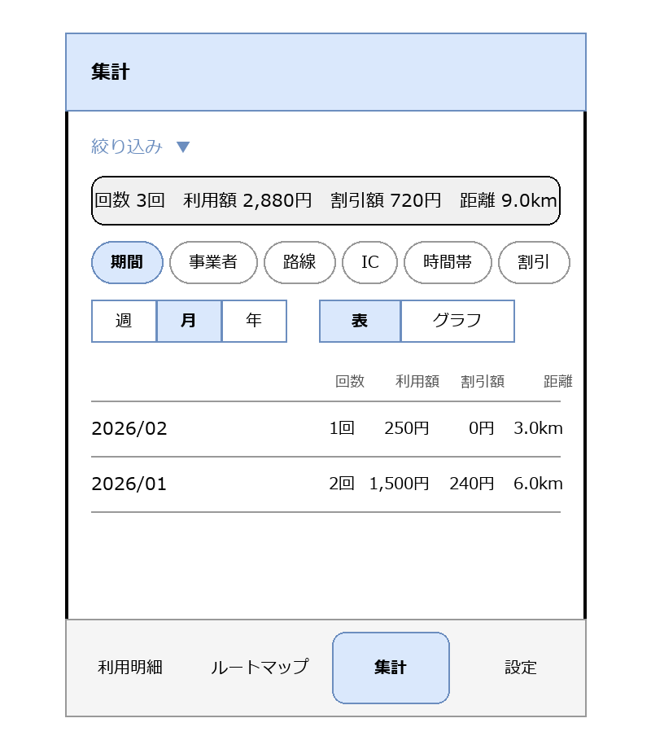
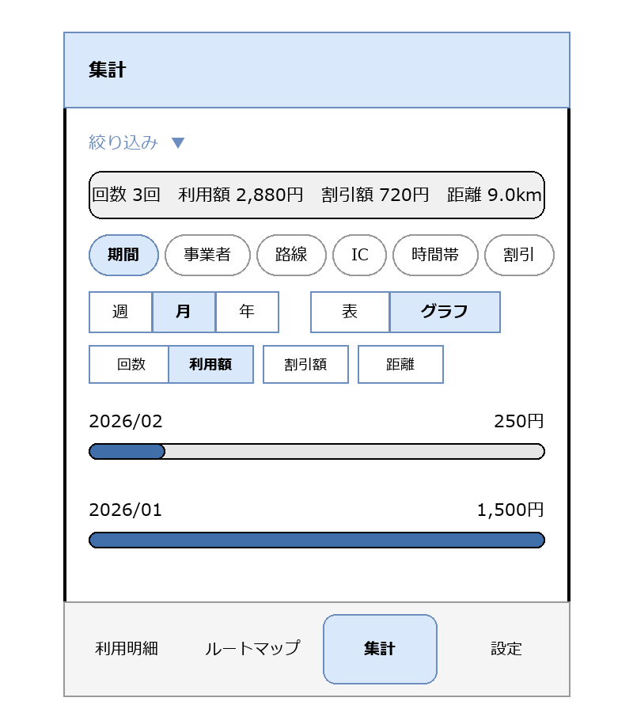
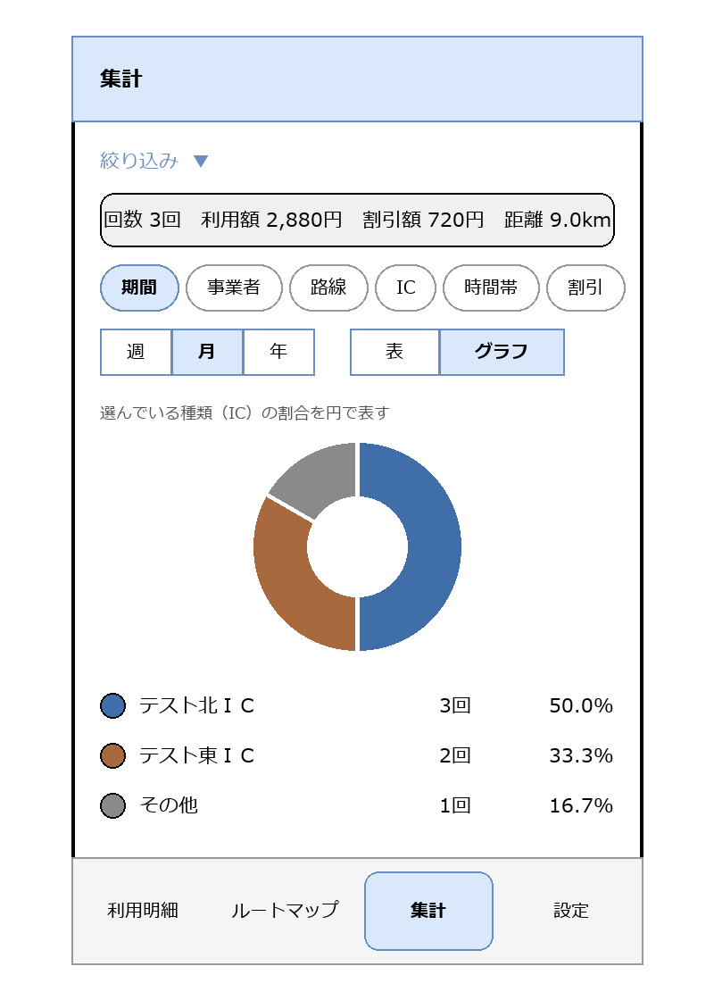

# SCR-006 集計

## 概要

絞り込んだ明細行を、期間・事業者・路線・IC・時間帯・割引種別で集計し、表またはグラフで表示する画面（[specification.md](../../specification.md) の 3.7）。定義は [aggregation.md](../../aggregation.md) に従う。

## 実装箇所

| 役割 | ファイル | クラス |
|---|---|---|
| 画面 | `lib/userinterface/aggregation/aggregation_screen.dart` | `AggregationScreen` |
| 表とグラフ | `lib/userinterface/aggregation/aggregation_views.dart` | `AggregationTable`、`AggregationBars` |
| 円グラフ | `lib/userinterface/aggregation/aggregation_pie.dart` | `AggregationPie`（円と凡例） |
| 画面の状態 | `lib/userinterface/aggregation/aggregation_controller.dart` | `aggregationProvider`（集計の取得）、`aggregationViewProvider`（種類・表示・単位・値の選択） |
| 画面の文言 | `lib/userinterface/aggregation/aggregation_strings.dart` | `AggregationStrings` |
| 依存の受け口 | `lib/userinterface/aggregation/aggregation_providers.dart` | `aggregateStatementsUCProvider`（実体は `lib/main.dart` で渡す） |
| 絞り込みの部品 | `lib/userinterface/statements/statement_filter_bar.dart` | `StatementFilterBar`（[SCR-002](SCR-002-statement-list.md) と共通。状態も共通） |
| 更新の通知 | `lib/userinterface/common/data_revision.dart` | `dataRevisionProvider` |
| 画面の切り替え | `lib/userinterface/app_shell.dart` | `AppShell`（下部のナビゲーションバー。「集計」を追加） |

棒グラフは、標準のウィジェットで描く。円グラフには、パッケージ `fl_chart` を使う。色は、アプリのテーマ（Material 3 の配色）から作る。

## 呼び出し箇所

- ルート `/aggregation`（`lib/userinterface/app.dart` の `GoRouter`）。下部のナビゲーションバーの「集計」で開く

## 基本設計

### 画面イメージ

表:

グラフ:

棒グラフ（期間別・時間帯別）:

円グラフ（事業者別・路線別・IC別・割引種別別）:

### 入出力項目一覧

| 項目 | 入力/出力 | 型 | 表示形式 |
|---|---|---|---|
| 絞り込み | 入力 | [SCR-002](SCR-002-statement-list.md) と同じ部品 | 「絞り込み」の見出しをタップして開閉する（初めは閉じる）。条件は SCR-002・SCR-005 と共通 |
| 合計 | 出力 | `AggregationSummaryDTO` | 「回数 12回　利用額 15,000円　割引額 1,200円　距離 123.4km」。距離が分からない明細行があるときは、その下に「距離が分からない明細行: N件（距離の合計に含みません）」 |
| 集計の種類 | 入力 | 選択（横に並べて選ぶ） | 「期間」「事業者」「路線」「IC」「時間帯」「割引」。初めは「期間」 |
| 期間の単位 | 入力 | 選択 | 「週」「月」「年」。種類が「期間」のときだけ表示する。初めは「月」 |
| 表示 | 入力 | 選択 | 「表」「グラフ」。初めは「表」。グラフの形は、集計の種類で決まる（[aggregation.md](../../aggregation.md) の「グラフの形」） |
| 値 | 入力 | 選択 | 「回数」「利用額」「割引額」「距離」。グラフに使う値なので、表示が「グラフ」で、出せる値が2つ以上あるときだけ表示する。表は、出せるすべての値を列にする。初めは「利用額」 |
| 表 | 出力 | `AggregationRowDTO` の一覧 | 1行ごとに、名前と、出せる値（回数「3回」、利用額・割引額「1,200円」、距離「12.3km」）。週は「2026/01/05〜」、月は「2026/01」、年は「2026年」、時間帯は「8時」 |
| 棒グラフ | 出力 | `AggregationRowDTO` の一覧 | 期間別・時間帯別。1行ごとに、名前と、値の大きさに比例する横棒と、値。棒の長さは、表示している行の最大値を1にした割合（最大が0のときは、棒なし） |
| 円グラフ | 出力 | `AggregationRowDTO` の一覧、`routesOtherCount`、`icsOtherCount` | 事業者別・路線別・IC別・割引種別別。値が0でない行を扇形にする。路線別・IC別は、残りを「その他」の扇形にする。円の下に、色・名前・値・割合（小数1桁の%）の凡例を並べる。すべて0のときは、「表示できる値がありません」 |
| 事業者の注記 | 出力 | 文字列 | 種類が「事業者」のときだけ、「路線名からの推定です」を表示する |
| 距離の注記 | 出力 | 文字列 | 値や列に「距離」があるとき（期間・事業者・時間帯の表、グラフの値が距離のとき）、「距離は道路に沿った道のりの推定です」を表示する |
| 処理中の表示 | 出力 | 進捗の表示 | 読み込み中は、進捗バーを表示する |

- 明細行が1件も無いとき、または絞り込みで0件のときは、表・グラフの場所に、利用明細一覧と同じ文言（「取り込んだ明細行がありません」「条件に合う明細行がありません」）を表示する。合計は表示しない
- 路線・ICの行は、上位10件だけ表示する

### 操作一覧

| 操作ID | 操作 | きっかけ | 動作 | 遷移先 |
|---|---|---|---|---|
| OP-1 | 集計を表示する | 画面を開く、または、CSVの取り込み・全削除、対応づけ・位置の登録・解除が終わる | 条件を指定して、集計を読み込み、表示する。終わったあとは、いま指定している条件のまま、読み込み直す | なし |
| OP-2 | 絞り込む | 絞り込みの操作 | 指定した条件で、読み込み直す。条件は SCR-002・SCR-005 と共通 | なし |
| OP-3 | 集計の種類を選ぶ | 種類のタップ | 選んだ種類の集計を表示する。値は、その種類で出せない値を選んでいたときだけ、「回数」に変える。読み込み直さない | なし |
| OP-4 | 期間の単位を選ぶ | 「週」「月」「年」のタップ | 期間別の行を、その単位に切り替える。読み込み直さない | なし |
| OP-5 | 表示を切り替える | 「表」「グラフ」のタップ | 表とグラフを切り替える。読み込み直さない | なし |
| OP-6 | 値を選ぶ | 「回数」「利用額」「割引額」「距離」のタップ | グラフに使う値を切り替える。読み込み直さない | なし |
| OP-7 | 再読み込みする | 「再読み込み」のタップ（ER-1 のとき） | 現在の条件で、読み込み直す | なし |

- 種類・単位・表示・値の選択は、画面を離れても保たれる（アプリを終了すると、初めに戻る）

### エラー一覧

| ID | 発生する場面 | 表示する文言（文字列定数） | 操作の続け方 |
|---|---|---|---|
| ER-1 | OP-1、OP-2 で、読み込みに失敗 | `AggregationStrings.loadFailed`（失敗の詳細は出さない） | OP-7 で、もう一度読み込む |

## 詳細設計

### 画面から呼ばれる処理

| 操作ID | 呼ぶ処理 | 設計書 |
|---|---|---|
| OP-1、OP-2、OP-7 | 明細行の集計（`AggregateStatementsUC`） | [PRC-013](../processes/PRC-013-aggregate-statements.md) |

- OP-3〜OP-6 は、画面の中で完結する（処理を呼ばない）。集計は、種類を切り替えても読み込み直さない（`AggregationDTO` に、すべての種類が入っている）
- 画面は `StatementLineEntity` を扱わない。結果は `AggregationDTO` で受け取る
- 車両番号・カード番号は、集計の行には出さない（絞り込みの選択肢だけに使う。[privacy.md](../../privacy.md)）

## 関連するテスト

- ウィジェット: `test/userinterface/aggregation/aggregation_screen_test.dart`（合計、種類・単位・表示・値の切り替え、表の値、棒グラフの棒の長さ、円グラフ（種類ごとの形、扇形と凡例の割合、その他、値が0の行、すべて0）、事業者の注記、上位10件、0件の文言、絞り込み、読み込み中、ER-1）
- ウィジェット: `test/userinterface/app_shell_test.dart`（ナビゲーションバーに「集計」があり、切り替えられること）
- 結合: `integration_test/aggregation_test.dart`（画面からDBまで。取り込んだ明細行が集計されること。絞り込むと変わること）
